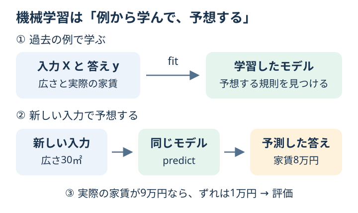

# ML Practice Lab

「機械学習って何をしているの？」から始める、図解つきの入門教材です。
身近な例でイメージをつかみ、短い Python コードを動かし、結果を見ながら少しずつ学びます。

機械学習は、**過去の例からパターンを見つけ、新しい例の答えを予想する方法**です。
たとえば「これまでの部屋の広さと家賃」を見て、別の部屋の家賃を予想します。



図の家賃は説明用の架空の例です。第0章で同じ題材を動かし、第1章から付属の花・手書き数字などのデータへ進みます。

## 初めての人はここから

1. [はじめての機械学習ガイド](docs/getting-started.md)を読む。「入力」「答え」「モデル」の意味から説明します。
2. 下の手順で**第0章の家賃予想**を動かす。最初から全部のコードを理解する必要はありません。
3. [第0章の図解と演習](exercises/ch00_first_prediction.md)で、自分の予想と画面の数字を見比べる。

[学習の道順と各章のゴール](docs/learning-path.md)で、次に何を学ぶか確認できます。

前提は「Python のファイルを実行できること」です。数学の公式や機械学習の知識は、最初は必要ありません。
Python も初めてなら、ガイドの[コードを読むための最低限の約束](docs/getting-started.md#コードを読むための最低限の約束)を先に見てください。

## セットアップ

Python 3.10 以上を用意してください。ターミナル（コマンドを入力するアプリ）を開き、
この教材のフォルダに移動して、次を1行ずつ実行します。`$` などの記号は入力しません。

macOS / Linux:

```bash
python3 -m venv .venv
.venv/bin/python -m pip install -r requirements.txt
.venv/bin/python scripts/ch00_first_prediction.py
```

Windows（PowerShell）:

```powershell
py -3 -m venv .venv
.venv\Scripts\python.exe -m pip install -r requirements.txt
.venv\Scripts\python.exe scripts/ch00_first_prediction.py
```

1行目は教材専用の Python 環境を作り、2行目は必要な道具を入れ、3行目は第0章を実行します。
環境を作る作業とインストールは初回だけで大丈夫です。
つまずいたら、ガイドの[よくあるつまずき](docs/getting-started.md#よくあるつまずき)を確認してください。

`make` が使える環境では、次のショートカットも利用できます。

```bash
make setup
```

すべての章のサンプルコードを実行します。

```bash
make run
```

構文・教材のリンク・評価手順を確認し、全章を実行します。

```bash
make check
```

解答例をまとめて実行します。

```bash
make answers
```

## 構成

```text
.
├── README.md
├── Makefile
├── requirements.txt
├── cheatsheet.md
├── docs/
│   ├── getting-started.md  # 身近な例・用語・最初の実行手順
│   ├── learning-path.md    # 学習順序・時間の目安・到達目標
│   ├── experiment-log.md   # 予想・実験・考察を記録するノート
│   ├── capstone.md         # 仕上げの総合課題
│   └── images/            # 各章の図解（インストール不要で読めます）
├── datasets/
│   ├── README.md
│   └── rent_practice.csv   # 120件の架空の部屋一覧
├── scripts/
│   ├── ch00_first_prediction.py
│   ├── ch01_basic_concepts.py
│   ├── ch02_regression.py
│   ├── ch03_classification.py
│   ├── ch04_metrics.py
│   ├── ch05_split_cv.py
│   ├── ch06_preprocessing.py
│   ├── ch07_tree_forest.py
│   ├── ch08_svm_knn.py
│   ├── ch09_clustering.py
│   ├── ch10_model_comparison.py
│   ├── ch11_parameter_search.py
│   ├── ch12_pca.py
│   ├── ch13_csv_regression.py
│   ├── ch14_learning_curves.py
│   ├── ch15_imbalanced_classification.py
│   ├── ch16_feature_importance.py
│   ├── ch17_model_persistence.py
│   ├── ch18_text_classification.py
│   ├── ch19_time_series.py
│   ├── predict_saved_rent.py # 保存したモデルで予測だけ行う
│   ├── make_rent_data.py   # 架空CSVの作り方・再生成
│   ├── visualize.py       # 実際のデータをグラフにする
│   ├── check_materials.py # 教材のリンク・章の構成を確認する
│   └── run_all.py
├── exercises/
│   └── chXX_*.md
├── answers/
│   ├── README.md          # 各問の解答の考え方
│   └── chXX_answer.py
└── tests/                # 評価手順などの確認
```

## 学習の進め方

各章の演習ページには、身近な例・図解・コードの読み方・結果の見方があります。

1. 演習ページの「この章でわかること」と図を見る。
2. 「実行」のコマンドでサンプルを動かす。
3. 「結果の見方」を読み、数字と意味を結びつける。
4. 「まずはここだけ」で、小さな変更を1つ試す。
5. 慣れてきたら練習問題に進み、必要なときに解答例を見る。

最初の区切りは**第0〜3章**です。「データから学ぶ」「数値を予想する」「種類を当てる」が説明できれば十分です。
第4〜6章で予測の確かめ方を学び、第7〜10章でさまざまな方法を比べます。
第11〜19章は発展編です。設定選び・PCA・CSVでの予測に加え、データの件数、不均衡な分類、手がかりの重要度を調べます。
モデルの保存と再利用、日本語の文章分類、時間順データの予測にも進めます。
基礎を一通り学んだら、興味のある章から取り組んで構いません。

各章の「この章のゴール」が説明できたら先に進みます。
変更前後の数値と考えた理由は[実験ノート](docs/experiment-log.md)に残し、
一通り学んだら[総合課題](docs/capstone.md)でモデル選びから最後の評価まで試してください。

## 実際のデータをグラフで見る

```bash
.venv/bin/python scripts/visualize.py
```

Windows では `.venv\Scripts\python.exe scripts/visualize.py` を使います。
`make` が使える場合は `make visuals` でも実行できます。

`outputs/figures/` に16枚の PNG 画像ができます。画像を開いて、各章の説明と見比べてください。
画面を表示できない環境でも、画像ファイルとして保存できます。

| 画像 | 見るポイント | 関連する章 |
| --- | --- | --- |
| `01_regression.png` | 点は実際のデータ、線は予測。点と線の縦の距離が誤差 | 1・2 |
| `02_classification.png` | 花の種類ごとに点の位置がどう違うか | 3 |
| `03_confusion_matrix.png` | 当たった件数と、間違えた件数の場所 | 4 |
| `04_cross_validation.png` | 学習する部分と確認する部分を入れ替える仕組み | 5 |
| `05_digits.png` | 手書きの数字が、8 × 8 個の数値として扱われること | 8 |
| `06_clustering.png` | 同じ点が、似たもの同士のグループに分かれる様子 | 9 |
| `07_overfitting.png` | 質問を細かくすると、学習用と検証用の成績がどう違うか | 7 |
| `08_decision_boundaries.png` | 同じ花のデータを、SVMとk-NNがどう分けるか | 3・8 |
| `09_parameter_search.png` | SVMの設定ごとのCVの平均とばらつき | 11 |
| `10_pca.png` | 4列の測定値をまとめた2軸の位置と、残せたばらつき | 12 |
| `11_csv_prediction.png` | CSVから予測した家賃と、実際とのずれ | 13 |
| `12_learning_curves.png` | 学習する件数で、学習用・検証用の成績がどう変わるか | 14 |
| `13_imbalanced_classification.png` | 少ない不良品の件数と、しきい値による指標の変化 | 15 |
| `14_feature_importance.png` | 1列を入れ替えると、家賃のずれが何万円増えるか | 16 |
| `15_text_classification.png` | 問い合わせの分類結果と、文章から作った数値の一部 | 18 |
| `16_time_series.png` | 日付順の境目と、翌日分の販売個数の予想のずれ | 19 |

日本語フォントがある環境では日本語で表示します。フォントがない場合は英語になり、
各章の「グラフで見る」で対応する日本語を確認できます。

## 章一覧

| 章 | テーマ | 実行コード | 演習 | 解答 |
| --- | --- | --- | --- | --- |
| 0 | 家賃の予想を動かしてみる | [コード](scripts/ch00_first_prediction.py) | [図解と演習](exercises/ch00_first_prediction.md) | [解答](answers/ch00_answer.py) |
| 1 | データから学ぶってどういうこと？ | [コード](scripts/ch01_basic_concepts.py) | [図解と演習](exercises/ch01_basic_concepts.md) | [解答](answers/ch01_answer.py) |
| 2 | 数値を予想する（回帰） | [コード](scripts/ch02_regression.py) | [図解と演習](exercises/ch02_regression.md) | [解答](answers/ch02_answer.py) |
| 3 | 種類を当てる（分類） | [コード](scripts/ch03_classification.py) | [図解と演習](exercises/ch03_classification.md) | [解答](answers/ch03_answer.py) |
| 4 | 予想はどれくらい当たった？（評価指標） | [コード](scripts/ch04_metrics.py) | [図解と演習](exercises/ch04_metrics.md) | [解答](answers/ch04_answer.py) |
| 5 | 初めて見る問題で確かめる（分割と交差検証） | [コード](scripts/ch05_split_cv.py) | [図解と演習](exercises/ch05_split_cv.md) | [解答](answers/ch05_answer.py) |
| 6 | データを使いやすく整える（前処理） | [コード](scripts/ch06_preprocessing.py) | [図解と演習](exercises/ch06_preprocessing.md) | [解答](answers/ch06_answer.py) |
| 7 | 質問を重ねて判断する（決定木・森） | [コード](scripts/ch07_tree_forest.py) | [図解と演習](exercises/ch07_tree_forest.md) | [解答](answers/ch07_answer.py) |
| 8 | 境界で分ける・近い例を見る（SVM・k-NN） | [コード](scripts/ch08_svm_knn.py) | [図解と演習](exercises/ch08_svm_knn.md) | [解答](answers/ch08_answer.py) |
| 9 | 似たものを集める（クラスタリング） | [コード](scripts/ch09_clustering.py) | [図解と演習](exercises/ch09_clustering.md) | [解答](answers/ch09_answer.py) |
| 10 | 同じ条件で方法を比べる（モデル比較） | [コード](scripts/ch10_model_comparison.py) | [図解と演習](exercises/ch10_model_comparison.md) | [解答](answers/ch10_answer.py) |

### 発展編

各章のページに、先に学んでおくと読みやすい章を載せています。

| 章 | テーマ | 実行コード | 演習 | 解答 |
| --- | --- | --- | --- | --- |
| 11 | モデルの設定を選ぶ（GridSearchCV） | [コード](scripts/ch11_parameter_search.py) | [図解と演習](exercises/ch11_parameter_search.md) | [解答](answers/ch11_answer.py) |
| 12 | たくさんの特徴を2軸で見る（PCA） | [コード](scripts/ch12_pca.py) | [図解と演習](exercises/ch12_pca.md) | [解答](answers/ch12_answer.py) |
| 13 | CSVから家賃を予測する | [コード](scripts/ch13_csv_regression.py) | [図解と演習](exercises/ch13_csv_regression.md) | [解答](answers/ch13_answer.py) |
| 14 | データを増やすと成績は変わる？（学習曲線） | [コード](scripts/ch14_learning_curves.py) | [図解と演習](exercises/ch14_learning_curves.md) | [解答](answers/ch14_answer.py) |
| 15 | 少ない不良品を見つける（不均衡な分類） | [コード](scripts/ch15_imbalanced_classification.py) | [図解と演習](exercises/ch15_imbalanced_classification.md) | [解答](answers/ch15_answer.py) |
| 16 | モデルが使う手がかりを調べる（重要度） | [コード](scripts/ch16_feature_importance.py) | [図解と演習](exercises/ch16_feature_importance.md) | [解答](answers/ch16_answer.py) |
| 17 | モデルを保存して、あとで使う | [コード](scripts/ch17_model_persistence.py) | [図解と演習](exercises/ch17_model_persistence.md) | [解答](answers/ch17_answer.py) |
| 18 | 日本語の問い合わせを分類する | [コード](scripts/ch18_text_classification.py) | [図解と演習](exercises/ch18_text_classification.md) | [解答](answers/ch18_answer.py) |
| 19 | 時間の順番を守って予測する | [コード](scripts/ch19_time_series.py) | [図解と演習](exercises/ch19_time_series.md) | [解答](answers/ch19_answer.py) |

## 使うデータ

主に scikit-learn 付属データセットを使います。外部ダウンロードなしで動きます。

- `load_diabetes`: 回帰
- `load_iris`: 花の品種を当てる分類
- `load_breast_cancer`: 二値分類、評価指標、モデル比較
- `load_digits`: 画像分類
- `make_blobs`: クラスタリングの人工データ
- `make_moons`: 学習曲線で使う2種類の人工データ
- `make_classification`: 少ない不良品を見つける練習用の人工データ
- `datasets/rent_practice.csv`: 読み込み・前処理・回帰の練習用の架空データ
- `make_messages()`: 教材用に書いた48件の架空の日本語の問い合わせ
- `make_sales()`: 曜日による波と増加を持つ210日分の架空の販売個数

## 学習メモ

- 最初は精度の高さより、データの形、学習、予測、評価の流れを理解することを優先してください。
- `random_state=42` は結果を再現しやすくするための固定値です。
- 章のコードは短くしてあります。慣れてきたら特徴量、モデル、評価指標を変更して結果を比較してください。
- わからない言葉は[日本語つきの用語早見表](cheatsheet.md)で確認できます。

## 教材の変更を確認する

`make check`・`make answers`・`make visuals` で確認できます。
解答でエラーが出たら、その章で実行を止めるため、失敗を見落としにくくなっています。
PRではLinuxとWindowsの実行確認もGitHub Actionsで行います。
