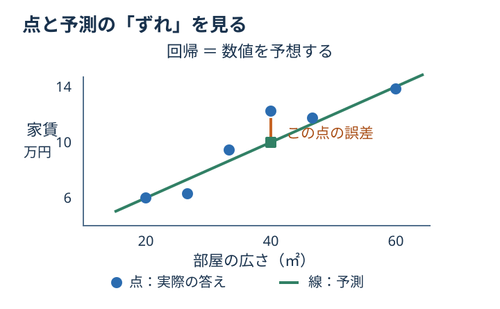

# Chapter 2: 回帰

## この章でわかること

**回帰**は「いくら？」「何度？」のような数値を予想する方法です。
予想と答えのずれを見て、予想の良し悪しを比べられるようになります。

## 身近な例と図解

家賃を8万円と予想し、実際は9万円なら、ずれは1万円です。
この「予想と答えのずれ」を**誤差**といいます。



図は家賃の架空の例です。コードでは、糖尿病データの10種類の手がかりから進行度を予測します。
`LinearRegression` は直線的な関係を学びます。
`Ridge` は、係数が大きくなりすぎるのを抑える仕組みを加えたモデルです。

## 実行

```bash
.venv/bin/python scripts/ch02_regression.py
```

## コードの読み方

| コード | していること |
| --- | --- |
| `train_test_split(...)` | データを学習用と確認用に分ける |
| `test_size=0.2` | 全体の約20%を確認用として取っておく |
| `fit(X_train, y_train)` | 学習用の例だけを使って学ぶ |
| `predict(X_test)` | 学習で使っていない例の答えを予想する |
| `evaluate_regression(...)` | 3つの方法で誤差を確かめる |
| `Ridge(alpha=1.0)` | 係数を抑える強さを `alpha` で指定する |

## 結果の見方

最初は **MAE だけ**を見てください。残りは慣れてからで大丈夫です。

| 表示 | かんたんな意味 | 良い方向 |
| --- | --- | --- |
| `MAE` | ずれの大きさの平均。ずれが10と20なら15 | 小さいほど良い |
| `RMSE` | 特に大きなずれを重く見る数値 | 小さいほど良い |
| `R2` | いつも平均値を答える方法と比べた良さ | 1に近いほど良い |

`R2` は正解率ではありません。0は平均値を答える方法と同程度、負の値はそれより悪いことを表します。
MAE と RMSE の単位は答えの数値と同じです。ここでの MAE は家賃の「万円」ではなく進行度の尺度です。

## グラフで見る

[グラフを生成](../README.md#実際のデータをグラフで見る)して `outputs/figures/01_regression.png` を開きます。
「1件の予測のずれ」（英語表示なら `Prediction error`）に注目します。図は見やすくするため BMI だけを使う単回帰で、
この章の10特徴量のモデルとは異なります。誤差のイメージをつかむために見てください。

## まずはここだけ

`Ridge(alpha=1.0)` を `Ridge(alpha=10.0)` に変え、MAE を比べてください。
変更前の数値をメモしておくと、どちらが良かったか確認できます。

## 練習問題

1. `Ridge(alpha=0.1)`, `Ridge(alpha=1.0)`, `Ridge(alpha=10.0)` を比較してください。
2. 各モデルの MAE、RMSE、R2 を表形式で表示してください。
3. `test_size=0.3` に変えたとき、結果がどのくらい変わるか確認してください。

## ヒント

```python
for alpha in [0.1, 1.0, 10.0]:
    model = Ridge(alpha=alpha)
```

<details>
<summary>理解の確認：MAE が15から10に変わったら？</summary>

同じ確認用データなら、平均的なずれが小さくなったと読めます。
確認用の問題まで変えた場合は、モデルの改善だけが理由とは限りません。

</details>

[解答例](../answers/ch02_answer.py) · [前の章](ch01_basic_concepts.md) · [次の章：種類を当てる](ch03_classification.md) · [教材の入口](../README.md)
