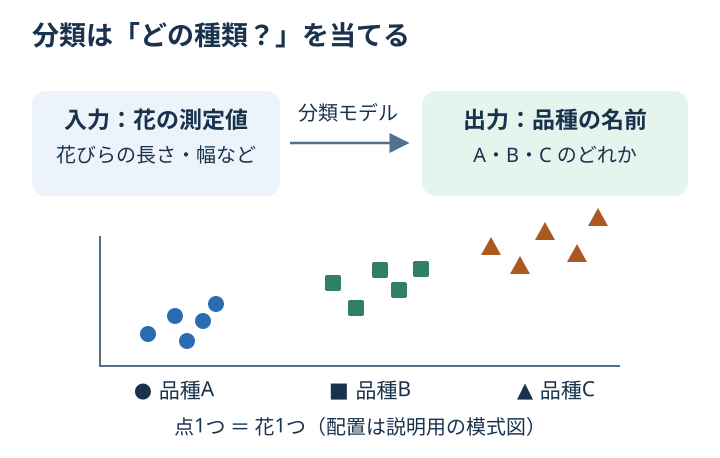

# Chapter 3: 分類

## この章でわかること

**分類**は「どの種類？」を予想する方法です。数値を予想する回帰との違いが説明できるようになります。
種類の名前を**ラベル**、種類そのものを**クラス**ともいいます。

## 身近な例と図解

花びらの長さや幅を測って、「どの品種の花だろう？」と予想します。
コードの Iris（アヤメ）データには3種類の品種があります。



品種を表す `0`・`1`・`2` は、名前の代わりにつけた番号です。
数値の大きさを予想しているわけではないので、これは回帰ではなく分類です。

## 実行

```bash
.venv/bin/python scripts/ch03_classification.py
```

## コードの読み方

| コード | していること |
| --- | --- |
| `load_iris(as_frame=True)` | 150件の花のデータを読み込む |
| `stratify=y` | 各品種の割合が学習用と確認用で近くなるよう分ける |
| `StandardScaler()` | 手がかりの数値の尺度をそろえる。第6章で説明する |
| `Pipeline(...)` | 数値を整える処理とモデルを、1つの手順にまとめる |
| `LogisticRegression(...)` | 種類を予想するモデルを準備する |
| `accuracy_score(y_test, pred)` | 実際の品種と予想を比べて正解率を求める |

`LogisticRegression` は名前に Regression とあっても、**分類用**のモデルです。

## 結果の見方

`accuracy: 0.9667` なら、約96.7%が正解です。これは読み方の例で、環境により数値は変わります。
`actual` は本当の品種、`predicted` は予想した品種です。まずは5件の予想が一致しているかを見てください。
全体の正解率と「最初の5件の正解数」は別のものです。

## グラフで見る

[グラフを生成](../README.md#実際のデータをグラフで見る)して `outputs/figures/02_classification.png` を開きます。
横軸は花びらの長さ、縦軸は幅で、単位は cm です。英語表示なら `Petal length` と `Petal width` です。
1つの点が1つの花で、色と形は本当の品種です。この図はデータの分布を示し、モデルの予測ではありません。
コードでは、図に出ていない2つを含む4つの手がかりを使います。

## まずはここだけ

`X = data.data` の下に `print(X.head(3))` を加えて、4列の測定値を見てください。
「この測定値から品種を当てる」とイメージできれば十分です。

## 練習問題

1. accuracy に加えて confusion matrix を表示してください。
2. `stratify=y` を外して実行し、テストデータのクラス分布がどう変わるか見てください。
3. `sepal length (cm)` と `sepal width (cm)` だけを使った場合の accuracy を確認してください。

## ヒント

```python
from sklearn.metrics import confusion_matrix

print(confusion_matrix(y_test, pred))
```

<details>
<summary>理解の確認：花の高さを予想するのも分類？</summary>

高さという数値を予想するなら回帰です。花の品種という種類を当てるなら分類です。

</details>

[解答例](../answers/ch03_answer.py) · [前の章](ch02_regression.md) · [次の章：予想を評価する](ch04_metrics.md) · [教材の入口](../README.md)
