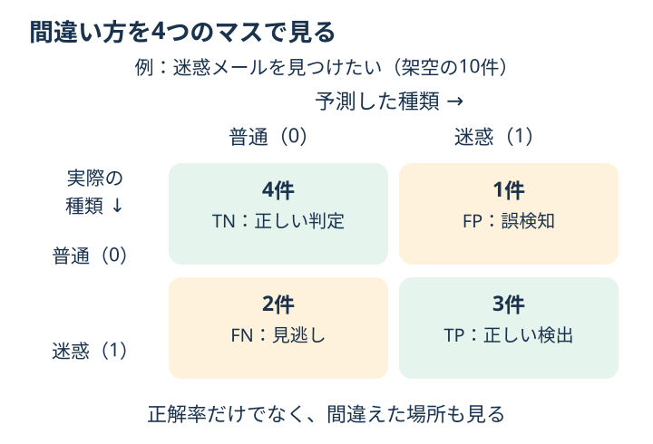

# Chapter 4: 評価指標

## この章でわかること

「何件当たったか」に加えて、**どんな間違いをしたか**を確認できるようになります。
最初は混同行列の4つのマスを読めれば十分です。

## 身近な例と図解

迷惑メールを見つける場合、「普通のメールを迷惑と間違える」と
「迷惑メールを見逃す」は、どちらも間違いですが困り方が違います。
**陽性**は、この例なら「見つけたい対象＝迷惑メール」です。「良い」という意味ではありません。



図は架空のメール10件です。実際のコードでは、乳がん診断の付属データを使い、**悪性を1（陽性）**とします。
データの元の番号では悪性が0なので、`(data.target == 0).astype(int)` で付け直しています。

## 実行

```bash
.venv/bin/python scripts/ch04_metrics.py
```

## コードの読み方

| コード | していること |
| --- | --- |
| `predict(X_test)` | 0か1の種類を予想する |
| `predict_proba(X_test)[:, 1]` | モデルが出す「1である確率」を取り出す |
| `confusion_matrix(y_test, pred)` | 実際の種類と予想を比べ、4種類の件数を数える |
| `pred = (prob >= threshold).astype(int)` | 指定したしきい値以上なら1と判定する |

**しきい値**は「どこから1と判定するか」の境目です。たとえば0.5なら、0.5以上を1にします。

## 結果の見方

混同行列は、行が実際の答え、列が予想です。順番はどちらも0・1です。

| 記号 | コードのデータでの意味 |
| --- | --- |
| TN（左上） | 良性を良性と判定 |
| FP（右上） | 良性を悪性と判定：誤検知 |
| FN（左下） | 悪性を良性と判定：見逃し |
| TP（右下） | 悪性を悪性と判定 |

| 指標 | 架空の図で計算すると | 見ていること |
| --- | --- | --- |
| accuracy（正解率） | (4 + 3) / 10 = 70% | 全体で何件当たったか |
| precision（適合率） | 3 / (1 + 3) = 75% | 陽性と予想した中で、何件本当に陽性か |
| recall（再現率） | 3 / (2 + 3) = 60% | 本当の陽性のうち、何件見つけられたか |
| F1 | 約0.67 | precision と recall の調和平均。単純な平均ではない |
| ROC-AUC | この4つの件数だけでは求められない | 陽性の例に陰性より高いスコアをつける力 |

ROC-AUC は通常1に近いほど良く、ランダムな順位づけは約0.5です。最初は後回しで大丈夫です。
たとえば100件中99件が陰性なら、全部を陰性と答えるだけでも accuracy は99%ですが、陽性を1件も見つけられません。

## グラフで見る

[グラフを生成](../README.md#実際のデータをグラフで見る)して `outputs/figures/03_confusion_matrix.png` を開きます。
行は実際の答え、列は予想した答えです。英語表示なら `Actual` は実際、`Predicted` は予想、`Benign` は良性、`Malignant` は悪性です。
このグラフは第4章と同じデータ・分割・モデルを使っています。右上と左下が間違いの件数です。

## まずはここだけ

`pred = model.predict(X_test)` の下に、まず `pred = (model.predict_proba(X_test)[:, 1] >= 0.3).astype(int)` を加えます。
しきい値を下げる前後で、見逃し（FN）と誤検知（FP）がどう変わるか確認してください。
同じ確率に対してしきい値を下げると陽性判定が増え、見逃しは増えず、誤検知は減りません。
この演習は、同じ予測に対するしきい値の影響を見るための比較です。
実際にしきい値を選ぶときは検証用で比較し、最後のテストは別に残します。第5章で学びます。

## 練習問題

1. 予測確率に対してしきい値 `0.3`, `0.5`, `0.7` を試してください。
2. 各しきい値で precision、recall、F1 を表示してください。
3. 悪性の見逃しを減らしたい場合、どのしきい値がよさそうか考えてください。

## ヒント

```python
pred = (prob >= threshold).astype(int)
```

## つまずいたとき

<details>
<summary>precisionとrecallの分母が、どちらかわからなくなった</summary>

precisionは「陽性と**予想した**中」、recallは「**本当に**陽性の中」です。
図の右の列（1+3件）と下の行（2+3件）を指して、分母を確認してください。

</details>

## この章のゴール

- [ ] 4つのマスを実際と予想の組として読める。
- [ ] 見逃しと誤検知を、件数でも確認できる。
- [ ] しきい値を変える前に、減らしたい間違いを言える。

<details>
<summary>理解の確認：見逃しを減らしたいなら、どの指標を見る？</summary>

recall と FN の件数です。recall が高いほど、本当の陽性を多く拾えています。
同時に precision と FP も見て、誤検知が増えていないか確かめます。

</details>

[解答例](../answers/ch04_answer.py) · [前の章](ch03_classification.md) · [次の章：確認用の問題を分ける](ch05_split_cv.md) · [教材の入口](../README.md)
