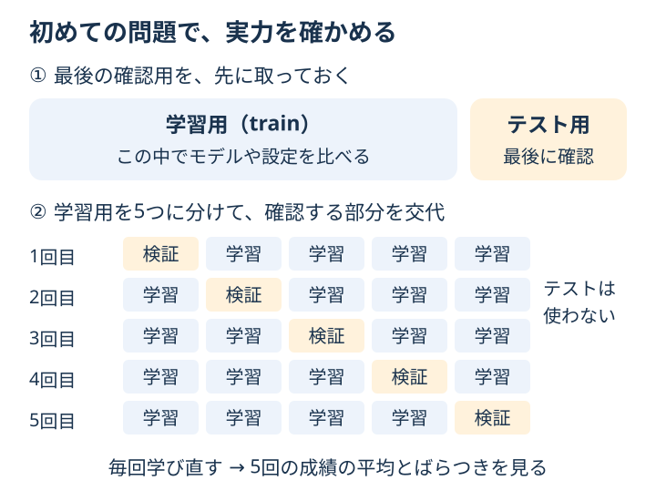

# Chapter 5: train/test split と cross validation

## この章でわかること

学習用と確認用を分ける理由と、確認する部分を入れ替えて評価する仕組みが説明できるようになります。

## 身近な例と図解

練習問題で満点でも、答えを覚えただけかもしれません。実力を確かめるには、初めての問題が必要です。
データも、**学習用（train）**と**最後の確認用（test）**に分けます。



さらに学習用を5つに分け、「4つで学ぶ → 残り1つで確認する」を5回繰り返すのが、
**5分割の交差検証（cross validation、CV）**です。毎回、モデルを学び直します。
5回の平均を見ると、1回の分け方だけで結論を出すのを避けられます。

## 実行

```bash
.venv/bin/python scripts/ch05_split_cv.py
```

## コードの読み方

| コード | していること |
| --- | --- |
| `train_test_split(..., test_size=0.25)` | 約25%を最後の確認用に取っておく |
| `StratifiedKFold(n_splits=5, ...)` | クラスの割合を近く保ちながら、5つに分ける方法を準備する |
| `cross_val_score(..., X_train, y_train, ...)` | 学習用の中だけで、5回の学習と検証を行う |
| `scores.mean()` | 5回の正解率の平均を求める |
| `scores.std()` | 正解率のばらつきを調べる |

この章では CV にテストデータを使いません。前処理も `Pipeline` にまとめ、各回の学習用だけから尺度を学びます。

## 結果の見方

- `cv scores`：5回それぞれの正解率です。
- `cv mean +/- std`：平均とばらつきです。`0.96 +/- 0.02` なら、平均約96%、標準偏差約2ポイントです。
- `holdout accuracy`：最後に取っておいたテストデータでの正解率です。

`+/- std` は「将来必ずこの範囲に収まる」という保証ではありません。
平均が同程度なら、ばらつきが大きくないかも見ます。
モデルや設定を選ぶときは学習用の CV で比べ、最後のテストを何度も見て調整しないようにします。

## グラフで見る

[グラフを生成](../README.md#実際のデータをグラフで見る)して `outputs/figures/04_cross_validation.png` を開きます。
学習用と検証用を見比べます。右側の最終テストは最後まで取っておきます。
英語表示なら `Training` が学習、`Validation` が検証、`Final test` が最終テストです。
5つの区画のうち、確認する区画が1行ずつ入れ替わっています。

## まずはここだけ

`n_splits=5` を `n_splits=3` に変えます。`cv scores` の数が5個から3個になることを確認してください。

## 練習問題

1. `n_splits=3`, `5`, `10` で cross validation を比較してください。
2. accuracy だけでなく F1 でも cross validation を実行してください。
3. 平均値だけでなく標準偏差も見て、評価のばらつきを確認してください。

## ヒント

```python
cross_val_score(model, X, y, cv=cv, scoring="f1")
```

<details>
<summary>理解の確認：5回の検証では、同じモデルを学習し続ける？</summary>

いいえ。各回で、選ばれた学習用データから新しく学び直します。
検証用の答えは、その回の学習には使いません。

</details>

[解答例](../answers/ch05_answer.py) · [前の章](ch04_metrics.md) · [次の章：データを整える](ch06_preprocessing.md) · [教材の入口](../README.md)
