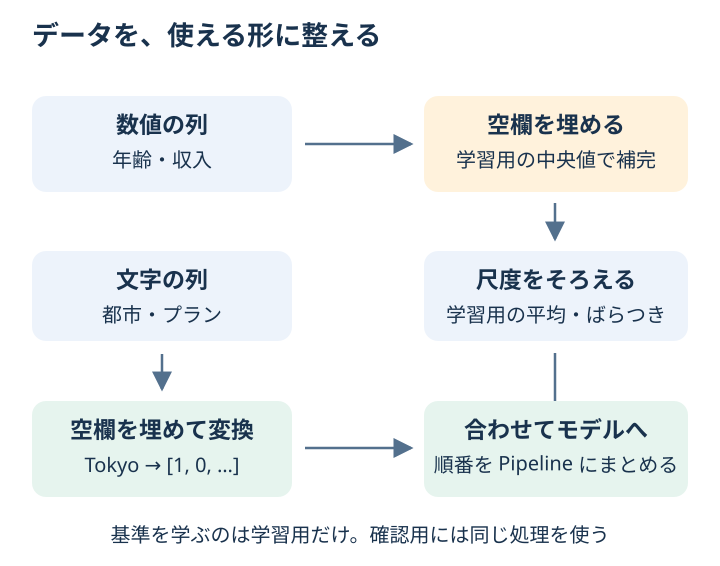

# Chapter 6: 前処理

## この章でわかること

空欄・数値・文字が混ざった表を、モデルが使える形に整えられるようになります。
この準備を**前処理**といいます。

## 身近な例と図解

アンケートの表には「年齢が未記入」「都市名が文字」「年齢と収入の桁が違う」といったことがあります。
この章では、16件の架空の顧客データから、プランをアップグレードするかを予想します。



| 処理 | 身近な言い方 | この章での方法 |
| --- | --- | --- |
| 欠損値の補完 | 空欄を仮の値で埋める | 数値は中央値、文字は最も多い値 |
| 標準化 | 数値の尺度をそろえる | 学習用の平均と標準偏差を使う |
| one-hot encoding | 種類ごとに「該当する？」の列を作る | Tokyo・Osaka などの列を0と1で表す |

Tokyo を `[1, 0]`、Osaka を `[0, 1]` とするイメージです。
Tokyo=1、Osaka=2 のように番号を大小のある数値として使わずに、種類の違いを表します。

## 実行

```bash
.venv/bin/python scripts/ch06_preprocessing.py
```

## コードの読み方

| コード | していること |
| --- | --- |
| `np.nan` | 値が欠けていることを表す |
| `SimpleImputer(strategy="median")` | 学習用の中央値で空欄を埋める |
| `StandardScaler()` | 数値を、平均が0・標準偏差が1になる尺度に変える |
| `OneHotEncoder(handle_unknown="ignore")` | 文字の種類を0と1の列にする。初めての種類はその列群をすべて0にする |
| `ColumnTransformer(...)` | 数値の列と文字の列に別々の処理をする |
| `Pipeline(...)` | 前処理から予測までを、順番にまとめる |

空欄を埋める値や標準化の基準は**学習用だけから求めます**。
確認用まで見て基準を決めると、答え合わせに使う問題の情報が先に入ってしまいます。これをデータ漏洩と呼びます。

## 結果の見方

`変換前の列` は、年齢・収入・都市・プランの4列です。
変換後は、都市とプランが種類ごとの列に分かれるため、特徴量の数が増えます。
このデータは確認用が4件だけなので、1件の正誤で正解率が25ポイント変わります。精度の結論より、処理の流れを見てください。

## まずはここだけ

`X, y = make_customer_data()` の下に `print(X.head(5))` を加えます。
5行目の年齢が `NaN`（空欄）でも、前処理を通せばモデルを学習できることを確認してください。

## 練習問題

1. 新しい顧客データを 1 件作り、アップグレード確率を予測してください。
2. 数値特徴量の欠損値補完を `mean` に変更して結果を確認してください。
3. one-hot encoding 後の特徴量名を表示してください。

## ヒント

```python
model.predict_proba(new_customer)[:, 1]
model.named_steps["preprocess"].get_feature_names_out()
```

<details>
<summary>理解の確認：標準化すると、どんな数値も0〜1になる？</summary>

なりません。StandardScaler は平均と標準偏差で尺度をそろえるので、負の値や1を超える値も出ます。
0〜1に収める方法とは別です。

</details>

[解答例](../answers/ch06_answer.py) · [前の章](ch05_split_cv.md) · [次の章：質問で判断する](ch07_tree_forest.md) · [教材の入口](../README.md)
