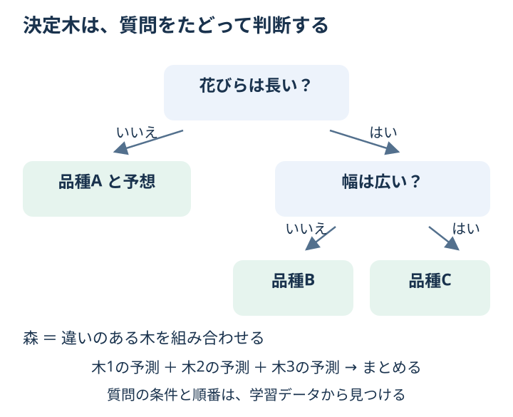

# Chapter 7: 決定木・ランダムフォレスト

## この章でわかること

質問を重ねる**決定木**と、いくつもの木を組み合わせる**ランダムフォレスト**の考え方がわかります。

## 身近な例と図解

「花びらは長い？」「幅は広い？」と、はい・いいえで質問をたどって品種を予想すると考えてください。
質問の条件や順番をデータから見つけるのが決定木です。



図の質問は説明用です。コードでは、診断データの測定値から良性・悪性を分類します。
木が深すぎると、細かな例外まで覚えて、初めてのデータにうまく対応できないことがあります。これが**過学習**です。
森は、データや手がかりに違いを持たせた複数の木の予測をまとめます。
分類では多数決のイメージで考えられますが、scikit-learn は各木のクラス確率を平均して決めます。

## 実行

```bash
.venv/bin/python scripts/ch07_tree_forest.py
```

## コードの読み方

| コード | していること |
| --- | --- |
| `DecisionTreeClassifier(max_depth=4)` | 質問の深さの上限を4にする |
| `RandomForestClassifier(n_estimators=100, ...)` | 100本の木を組み合わせる |
| `model.fit(X_train, y_train)` | 分岐する条件を学ぶ |
| `feature_importances_` | 木の分岐で、どの手がかりがどれほど使われたかを見る |

## 結果の見方

表の `accuracy` は正解率、`f1` は悪性の検出について precision と recall をまとめた値です。
同じ確認用データなので、2つのモデルを比較できます。
森のほうが常に良いとは限りません。表示された結果で確かめてください。
重要特徴量の値は合計すると1です。ただし、重要度が高くても「病気の原因」とは言えず、計算方法にも偏りがあります。

## まずはここだけ

決定木の `max_depth=4` を `max_depth=2` に変えてください。
質問を少なくしたとき、確認用での正解率がどう変わるか見ます。

## 練習問題

1. `max_depth` を `2`・`4`・`None` にした3つの決定木を比較してください。`None` は深さの上限なしです。
2. `n_estimators` を `50`・`150` にした2つのランダムフォレストを比較してください。
3. feature importance の top 10 を表示してください。

## ヒント

```python
model.feature_importances_
```

<details>
<summary>理解の確認：質問を増やせば、初めての問題でも必ず良くなる？</summary>

必ず良くなるわけではありません。学習用の例外まで覚えてしまう場合があります。
学習用での成績だけでなく、使っていないデータで確認します。

</details>

[解答例](../answers/ch07_answer.py) · [前の章](ch06_preprocessing.md) · [次の章：境界と近い例](ch08_svm_knn.md) · [教材の入口](../README.md)
