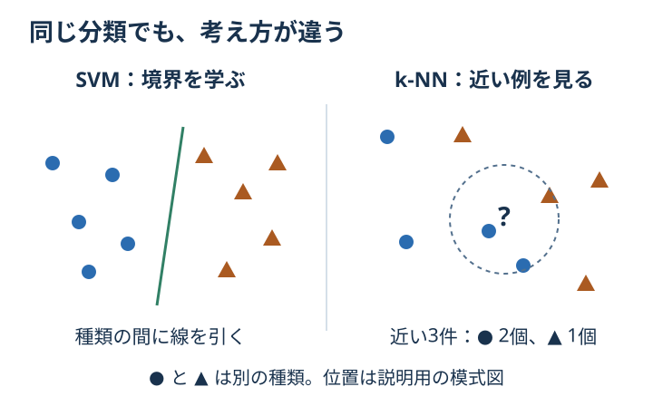

# Chapter 8: SVM と k-NN

## この章でわかること

「境界を引く」と「近い例を見る」という、2つの分類方法の違いがわかります。

## 身近な例と図解

果物を重さと大きさで分けると考えます。
**SVM** は、種類の間の境界を学びます。基本のイメージは、両側の点からできるだけ余裕のある境界を引くことです。
**k-NN** は、新しい果物に近い例を k 個集めて、多いほうの種類を答えます。



図は2種類の模式図です。コードでは、0〜9の手書き数字を分類します。
SVM は `kernel="rbf"` を使うため、曲がった境界も扱えます。
どちらも数値の尺度の影響を受けるので、`StandardScaler` を組み合わせます。

## 実行

```bash
.venv/bin/python scripts/ch08_svm_knn.py
```

## コードの読み方

| コード | していること |
| --- | --- |
| `load_digits()` | 8 × 8 ピクセルの手書き数字画像を読み込む |
| `data.data` | 1枚の画像を64個の明るさの数値に並べた表を取り出す |
| `SVC(kernel="rbf", C=10, ...)` | 曲がった境界も扱える SVM を準備する |
| `C` | 学習データの間違いをどれだけ強く抑えるかを調整する |
| `KNeighborsClassifier(n_neighbors=5)` | 近い5件の多数決で予想する |

`C` を大きくすれば常に良くなるわけではありません。`k` も、近すぎる例だけを見るか、広く見るかの調整です。

## 結果の見方

表の `accuracy` を比べます。画像の形 `(1797, 8, 8)` は「1797枚、高さ8、幅8」です。
モデルに渡す表では `(1797, 64)` になり、1つのピクセルが1つの手がかりになります。

## グラフで見る

[グラフを生成](../README.md#実際のデータをグラフで見る)して `outputs/figures/05_digits.png` を開きます。
「本当の数字」（英語表示なら `Actual digit`）と画像を見比べます。四角の明るさが数値になり、モデルに渡されます。
ここでは画像の中身を見るため、本当の数字を表示しています。モデルの予測結果ではありません。

`outputs/figures/08_decision_boundaries.png` では、花びらの2つの測定値をSVMとk-NNで分類します。
背景色がモデルの予想、点の色と形が本当の品種です。大きな枠付きの点が確認用です。
背景と点の色が違う場所では、予想を間違えています。
この図のSVMは直線の境界を見る `kernel="linear"` です。数字を使うこの章の `rbf` とは条件が違うので、成績の数値を直接比べません。

## まずはここだけ

`n_neighbors=5` を `n_neighbors=1` に変えます。「一番近い1件だけ」で決めたときの正解率を見てください。

## 練習問題

1. SVM の `C` を `0.5`, `3`, `10` で比較してください。
2. k-NN の `n_neighbors` を `3`, `5`, `11` で比較してください。
3. 標準化を外すと accuracy が変わるか確認してください。

## ヒント

```python
Pipeline([("scale", StandardScaler()), ("clf", SVC(C=3))])
```

## つまずいたとき

<details>
<summary>標準化を外したほうが正解率が高くなった</summary>

標準化は必ず正解率を上げる道具ではありません。距離の計算で、数値の尺度をそろえる処理です。
手書き数字の画素は同じ単位です。SVMのCやk-NNのkを同じにし、標準化の有無だけで比べたか確認します。

</details>

## この章のゴール

- [ ] SVMの境界とk-NNの近い例の違いを説明できる。
- [ ] 画像1枚が64個の手がかりになることを説明できる。
- [ ] 標準化が常に精度を上げるとは限らないと言える。

<details>
<summary>理解の確認：k=3 で近い例が A・A・B なら？</summary>

通常の、同じ重みでの多数決では A を予想します。3件のうち2件が A だからです。

</details>

[解答例](../answers/ch08_answer.py) · [前の章](ch07_tree_forest.md) · [次の章：似たものを集める](ch09_clustering.md) · [教材の入口](../README.md)
