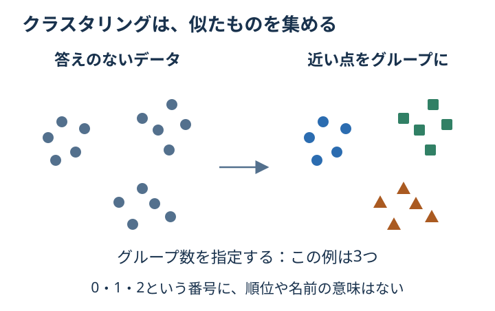

# Chapter 9: クラスタリング

## この章でわかること

答えのラベルを渡さずに、似たもの同士を集める**クラスタリング**がわかります。
できたグループを**クラスタ**と呼びます。

## 身近な例と図解

買い物の回数と金額から、お客さんを似た傾向のグループに分けると考えてください。
あらかじめ「この人はグループA」と教えるのではなく、データの近さで分けます。



**KMeans** は、グループの中心を置き、「近い中心に割り当てる → 中心を更新する」を繰り返します。
グループ数は `n_clusters` でこちらが指定します。
コードでは、見やすい2つの特徴量を持つ人工データを作っています。

## 実行

```bash
.venv/bin/python scripts/ch09_clustering.py
```

## コードの読み方

| コード | していること |
| --- | --- |
| `make_blobs(centers=3, ...)` | 3つのまとまりがある練習用データを作る |
| `StandardScaler().fit_transform(X)` | 2つの手がかりの尺度をそろえる |
| `KMeans(n_clusters=3, ...)` | 3グループに分けるモデルを準備する |
| `fit_predict(X_scaled)` | データから中心を求め、各点のグループ番号を返す |
| `cluster_centers_` | 学んだグループの中心を見る |

`true_labels` は、人工データを作ったときの元のグループです。
KMeans には渡していません。答えを知っているのは、結果を確認するためです。

## 結果の見方

| 表示 | 見ていること |
| --- | --- |
| `silhouette score` | グループ内で近く、別グループから離れているか。-1〜1で高いほどその観点では良い |
| `adjusted rand score` | 元のグループと分け方がどれだけ一致するか。1は完全一致、偶然の一致はおおむね0 |
| `cluster centers` | 標準化した座標での各グループの中心 |

グループ0・1・2という番号に、順位や名前の意味はありません。
実際の顧客データでは、グループの特徴を見てから「買い物回数が多い層」などの意味を考えます。
silhouette が高くても、用途に合うグループとは限りません。

## グラフで見る

[グラフを生成](../README.md#実際のデータをグラフで見る)して `outputs/figures/06_clustering.png` を開きます。
左が分ける前、右が分けた後です。英語表示なら `Before grouping` と `After KMeans` です。
同じ300個の点に、予測したグループごとに色と形をつけています。大きい × がグループの中心です。

## まずはここだけ

`n_clusters=3` を `n_clusters=2` に変えます。表示される中心が2個になることを確認してください。
人工データの元のグループ数（`centers=3`）は変えずに、分け方だけを変えます。

## 練習問題

1. `n_clusters=2`, `3`, `4`, `5` を比較してください。
2. 各クラスタ数の silhouette score を表示してください。
3. true label がある人工データなので、adjusted rand score も確認してください。

## ヒント

```python
KMeans(n_clusters=k, n_init=10, random_state=42)
```

## つまずいたとき

<details>
<summary>n_clustersを変えるとき、make_blobsのcentersも変える？</summary>

この演習では変えません。比較したいのは同じ点の分け方です。
元のデータの `centers=3` は固定し、KMeansのグループ数だけを変えてください。
本当のラベルをモデルに渡していないかも確認します。

</details>

## この章のゴール

- [ ] 分類と違い、正解ラベルを使わずに分けると説明できる。
- [ ] データを固定して、グループ数だけを変えて比べられる。
- [ ] グループ番号の意味は、結果を見てから考えると言える。

<details>
<summary>理解の確認：グループ0は「良いお客さん」を意味する？</summary>

意味しません。番号はグループを区別するための目印です。
どんな特徴の人が集まったかを調べてから、解釈します。

</details>

[解答例](../answers/ch09_answer.py) · [前の章](ch08_svm_knn.md) · [次の章：方法を比べる](ch10_model_comparison.md) · [教材の入口](../README.md)
