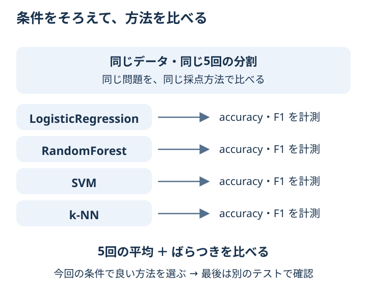

# Chapter 10: 簡単なモデル比較

## この章でわかること

ここまでに学んだ方法を、**同じ条件**で比べられるようになります。
「何を大切にしたいか」に合わせて、比較する指標を選びます。

## 身近な例と図解

4人の実力を比べるのに、1人だけ簡単な問題を解いたら公平に比べられません。
モデルも、同じデータ・同じ分け方・同じ採点方法で比べます。



この章では、診断データで LogisticRegression・RandomForest・SVM・k-NN を比べます。
4つのモデルの名前や設定を全部暗記する必要はありません。まずは比較表を読んでください。

## 実行

```bash
.venv/bin/python scripts/ch10_model_comparison.py
```

## コードの読み方

| コード | していること |
| --- | --- |
| `models = {...}` | 比べたい4つのモデルを名前と一緒に用意する |
| `StratifiedKFold(..., random_state=42)` | 全モデルに共通の分け方を決める |
| `cross_validate(..., scoring={...})` | 同じ5回の分割で、複数の指標を測る |
| `scores["test_f1"].mean()` | 5回の F1 の平均を求める |
| `sort_values("f1_mean", ascending=False)` | F1 の平均が高い順に表を並べる |

## 結果の見方

| 列 | 意味 |
| --- | --- |
| `model` | モデル名 |
| `accuracy_mean` | 正解率の平均 |
| `accuracy_std` | 正解率のばらつき |
| `f1_mean` | 悪性の検出についての F1 の平均 |
| `f1_std` | F1 のばらつき |

一番上のモデルは、**今回のデータと条件で、F1 の平均が最も高かったモデル**です。
すべての用途で一番という意味ではありません。差が小さければ、ばらつきや計算時間なども考えます。
ここでの CV は候補の比較です。実際にモデルを選んで使う際は、第5章のように別のテストデータを取っておき、最後に評価します。

## まずはここだけ

結果の表から、F1 の平均が一番高いモデルと、F1 のばらつきが一番小さいモデルを探してください。
同じモデルとは限りません。コードを変えずに、表を読むだけで大丈夫です。

## 練習問題

1. scoring に `recall` を追加してください。
2. F1 が最も高いモデル名を表示してください。
3. 評価結果を `outputs/model_comparison.csv` に保存してください。

## ヒント

```python
scores = cross_validate(model, X, y, scoring={"accuracy": "accuracy", "f1": "f1", "recall": "recall"})
from pathlib import Path

Path("outputs").mkdir(exist_ok=True)
result.to_csv("outputs/model_comparison.csv", index=False)
```

<details>
<summary>理解の確認：片方だけ別のデータ分割で、精度が高ければ優秀？</summary>

その比較だけでは判断できません。解いた問題の違いが、成績の差につながった可能性があります。
分け方をそろえてから比べます。

</details>

[解答例](../answers/ch10_answer.py) · [前の章](ch09_clustering.md) · [用語早見表](../cheatsheet.md) · [教材の入口](../README.md)
