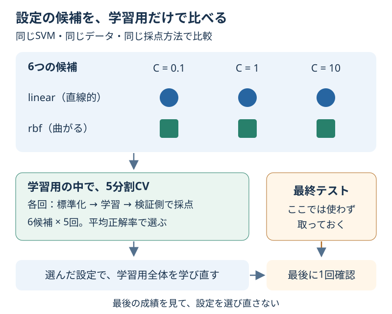

# Chapter 11: モデルの設定を選ぶ

[学習の道順](../docs/learning-path.md) · 発展編（第5・6・8・10章の後がおすすめ）

## この章でわかること

モデルの種類だけでなく、**モデルの設定も同じ条件で比べる**方法がわかります。
候補を自動で試す `GridSearchCV` を使い、最後のテストを残して設定を選びます。

## 身近な例と図解

カメラの設定を選ぶ場面を考えてください。同じ景色をいくつかの設定で撮り、見比べて選びます。
機械学習でも、使うデータと採点方法をそろえて、設定だけを変えます。



この章は第3章の花のデータと、第8章のSVMを使います。
設定の正式な名前は「ハイパーパラメータ」です。モデルが学ぶ前に、人が候補を決める値と考えてください。

| 設定 | 今回の候補 | 大まかな役割 |
| --- | --- | --- |
| `C` | 0.1・1・10 | 大きいほど、学習中の間違いを強く減らそうとする |
| `kernel` | `linear`・`rbf` | 境界の作り方を変える。直線的な境界・曲がった境界 |

3 × 2 = 6候補です。Cが大きい、境界が複雑、というだけで新しい例に強くなるとは限りません。

## 実行

```bash
.venv/bin/python scripts/ch11_parameter_search.py
```

Windowsは `.venv\Scripts\python.exe scripts/ch11_parameter_search.py` です。

## コードの読み方

| コード | していること |
| --- | --- |
| `Pipeline([("scale", ...), ("clf", ...)])` | 標準化とSVMをまとめ、CVの学習側だけから両方を学ぶ |
| `"clf__C": [0.1, 1, 10]` | `clf`という名前のSVMの、Cの候補を指定する |
| `GridSearchCV(..., scoring="accuracy")` | 各候補の5回の正解率を比べる |
| `search.fit(X_train, y_train)` | 最終テストを使わず、設定を選ぶ |
| `search.best_params_` | 選ばれた設定を読む |
| `search.predict(X_test)` | 選んだ設定で、最後に取っておいた例を予想する |

`__` はアンダースコア2個です。`clf`はコード内で付けた名前で、特別な予約語ではありません。
`refit=True` は、選んだ設定で学習用すべてを学び直す指定です。
6候補 × 5分割 = 30回の学習に加えて、この学び直しが1回あります。

## 結果の見方

`CV平均` は5回の正解率の平均、`CVばらつき` はその標準偏差、`順位` は平均が高い順の順位です。
同率なら候補を調べた順で最初の設定が選ばれます。差が小さい候補が、明確に優劣のつく候補とは限りません。

出力例です。道具のバージョンによって小数が多少変わる場合があります。

```text
選んだ設定: {'clf__C': 0.1, 'clf__kernel': 'linear'}
設定選びに使ったCVの平均: 0.9822
最後に取っておいた38件の正解率: 0.9211
```

0.9822は約98.2%、0.9211は約92.1%です。CVで選んだ成績が、そのまま別の例でも出るとは限りません。

「設定選びに使ったCV」と「最後に取っておいた正解率」は役割が違います。
最後の成績を見てCを変更したら、そのテストも設定選びに使ったことになります。
別の候補を試す練習はCVの表で比較し、最終テストは練習ごとに繰り返して最良値を探さないようにします。

## グラフで見る

`scripts/visualize.py` を動かすと `outputs/figures/09_parameter_search.png` ができます。
縦軸はCVの平均正解率、点の上下の線は5回の標準偏差です。線は信頼区間を表していません。
英語表示なら `Mean CV accuracy` が平均正解率、`C (log scale)` がCの対数目盛です。
0.1 → 1 → 10はそれぞれ10倍になるので、横軸の間隔を等しく描いています。

## まずはここだけ

コードを変える前に、表から「候補はいくつか」「どの列で選んだか」を言ってみてください。
次に、最終テストの数値がCVの比較表に入っていないことを確認します。

## 練習問題

1. Cの候補に100を加え、候補数とCVでの学習回数を求めてください。
2. 選ばれた設定と最終テストの正解率を表示し、「Cが大きければ必ず良いか」をCVの表から説明してください。
3. 全候補のCV比較表を `outputs/parameter_search.csv` に保存してください。

## ヒント

`build_search([0.1, 1, 10, 100])` で候補を変えられます。
`comparison_table(search)` が表を返し、`len(result) * search.n_splits_` がCVでの学習回数です。
CSVは `result.to_csv(path, index=False)` で保存できます。先に保存先のフォルダを作ります。

## つまずいたとき

<details>
<summary>Invalid parameterというエラーが出る／標準化は先に済ませていい？</summary>

`clf__C`の大文字C、アンダースコア2個、Pipelineの名前`clf`が一致しているか確認します。
CVの前に全データを標準化すると、検証側の平均なども先に使ってしまいます。
標準化を含んだPipeline全体をGridSearchCVに渡してください。

</details>

## この章のゴール

- [ ] 候補数と、CVでの学習回数を数えられる。
- [ ] 設定選びのCVと、最後のテストの役割を分けて説明できる。
- [ ] 前処理もCVの学習側だけから学ぶ理由を言える。

<details>
<summary>理解の確認：候補を100通りに増やせば、必ず良いモデルになる？</summary>

必ず良くなるわけではありません。計算も増え、同じCVに何度も合わせれば、たまたま良い設定を選ぶ可能性もあります。
CVで選んだ後に別のテストで確かめる手順が必要です。

</details>

[解答例](../answers/ch11_answer.py) · [前の章](ch10_model_comparison.md) · [次の章](ch12_pca.md) · [用語早見表](../cheatsheet.md) · [教材の入口](../README.md)

詳しい仕様は[GridSearchCVの公式説明](https://scikit-learn.org/stable/modules/generated/sklearn.model_selection.GridSearchCV.html)を参照してください。
