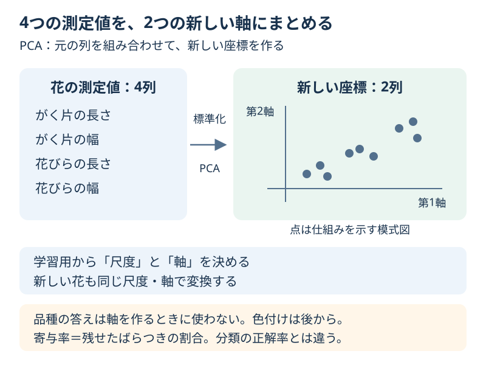

# Chapter 12: たくさんの特徴を2軸で見る

[学習の道順](../docs/learning-path.md) · 発展編（第3・6・9章の後がおすすめ）

## この章でわかること

たくさんの特徴量を少ない軸にまとめる「次元削減」を体験します。
**4つの測定値を組み合わせて2つの軸を作る**PCA（主成分分析）で、花のデータを眺めます。

## 身近な例と図解

物を別の角度から撮ると、同じ物でも見え方が変わります。
PCAも、点の広がりを見渡しやすい向きに軸を取り直す、と考えてみてください。
軸を減らすので、元の細かい違いの一部は失われます。



第3章の「花びらの長さ・幅を選ぶ」のとは違い、4列の値を組み合わせて新しい2列を作ります。
第9章のクラスタリングはグループを作りましたが、この章は点の座標を作ります。

## 実行

```bash
.venv/bin/python scripts/ch12_pca.py
```

Windowsは `.venv\Scripts\python.exe scripts/ch12_pca.py` です。

## コードの読み方

| コード | していること |
| --- | --- |
| `StandardScaler()` | 学習用の各測定値の尺度をそろえる |
| `PCA(n_components=2)` | 広がりを残せるように2つの軸を作る |
| `projection.fit_transform(X_train)` | 学習用から尺度と軸を決め、座標を求める |
| `projection.transform(X_check)` | 確認用を、すでに決めた尺度と軸で表す |
| `explained_variance_ratio_` | 各軸に残せた、学習用のばらつきの割合を読む |

PCAの軸を作るときは品種の答えを渡していません。教師なし学習です。
品種は分割の割合をそろえるためと、変換後の点を色付けするために使います。
PCA自体は尺度をそろえないので、この例では先に標準化しています。

## 結果の見方

`(112, 4) → (112, 2)` のような表示は、「112件の花はそのままで、4列を2列にした」という意味です。
軸の値がマイナスでもエラーではありません。軸上の位置を表しています。
第1軸・第2軸は測定値の組み合わせなので、cm単位の長さとしては読めません。

「寄与率」は、**標準化した学習用のばらつきを、その軸にどれだけ残せたか**です。
2軸の寄与率を足したものが「累積寄与率」です。
たとえば合計0.95なら95%のばらつきを残せたという意味で、「95%の花の品種が当たる」ではありません。
分類に大切な小さな違いが失われることもあります。

出力例です。最後の桁は道具のバージョンなどによって変わる場合があります。

```text
第1軸の寄与率: 73.9%
第2軸の寄与率: 22.1%
2軸の累積寄与率: 96.0%
```

この例は、4列にあったばらつきの約96%を2軸で表せた、と読みます。

## グラフで見る

`scripts/visualize.py` で `outputs/figures/10_pca.png` を作れます。
左は4列をまとめた2軸の座標、右は1〜4軸までの累積寄与率です。
左の色と形は本当の品種で、モデルの予測ではありません。大きな枠付きの点は確認用です。
英語なら `Principal component 1/2` は第1軸・第2軸、`Cumulative explained variance` は累積寄与率です。

点の色がよく分かれて見えても、それだけで分類の成績が良いとは判断できません。
第1軸の符号が反転した図でも、点同士の距離や残したばらつきは変わりません。

## まずはここだけ

表示された「行数・列数」の変化を見て、減ったのは花の数か測定値の列数か答えてください。
次に、第1軸と第2軸の寄与率を足して、合計表示とほぼ一致するか確かめます。丸めによる小さな差は構いません。

## 練習問題

1. 軸の数を1・2・3に変え、同じ学習用で累積寄与率を比べてください。
2. 2軸の場合の寄与率をそれぞれ表示し、足した値を確認してください。
3. 確認用の最初の5件を同じ2軸に変換し、本当の品種名と並べてください。

## ヒント

`build_projection(count).fit(X_train)` で軸の数を指定できます。
`projection.named_steps["pca"].explained_variance_ratio_` が各軸の割合です。
新しい例には `transform(X_check.iloc[:5])` を使います。`fit_transform`で軸を作り直しません。

## つまずいたとき

<details>
<summary>品種を当てるpredictがない／4軸より多くするとエラーになる</summary>

このPipelineは座標を作るためのものです。`predict`ではなく`transform`を使います。
今回の入力は4列なので、作れる軸は最大4つです。軸を増やしても新しい測定情報が生まれるわけではありません。
確認用にも`fit`すると尺度や軸が別になるので、同じ図の位置として比べられなくなります。

</details>

## この章のゴール

- [ ] 列を選ぶことと、列を組み合わせて新しい軸を作ることの違いを言える。
- [ ] 学習用から決めた尺度・軸で、新しい例も変換できる。
- [ ] 寄与率を、分類の正解率と区別して説明できる。

<details>
<summary>理解の確認：PCAは、花の品種が分かれるように軸を選んだ？</summary>

この例では品種ラベルを渡していません。標準化した特徴量の広がりだけを見て軸を作ります。
図の品種の色は、変換した後で付けています。

</details>

[解答例](../answers/ch12_answer.py) · [前の章](ch11_parameter_search.md) · [次の章](ch13_csv_regression.md) · [用語早見表](../cheatsheet.md) · [教材の入口](../README.md)

詳しい定義は[PCAの公式説明](https://scikit-learn.org/stable/modules/generated/sklearn.decomposition.PCA.html)を参照してください。
