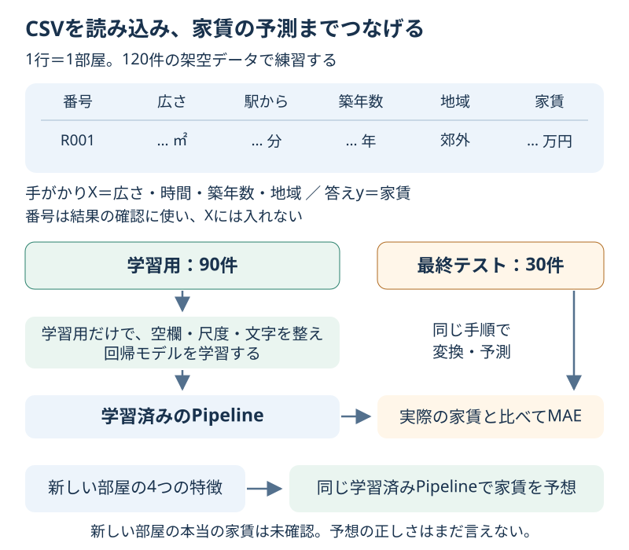

# Chapter 13: CSVから家賃を予測する

[学習の道順](../docs/learning-path.md) · 発展編（第0・2・5・6章の後に取り組めます）

## この章でわかること

これまでの学習・前処理・評価をつなげ、**CSVの読み込みから、新しい1件の予測まで**を体験します。
第0章の家賃予想に、駅からの時間・築年数・地域という手がかりを足します。

## 身近な例と図解

部屋探しの一覧を想像してください。広さだけでなく、駅への近さや築年数もあります。
1行を1部屋、1列を1種類の手がかりとして読み込み、家賃を答えにします。



[rent_practice.csv](../datasets/rent_practice.csv) は120件の**架空の部屋**です。
実在の物件や実際の相場ではありません。ダウンロードやアカウントの登録は不要です。
空欄がある手がかりと、文字の地域も含め、表の準備を練習できるようにしています。

| 列 | 意味 | 使い方 |
| --- | --- | --- |
| `room_id` | 部屋の番号 | 結果の確認用。学習の手がかりには入れない |
| `area_sqm` | 広さ（㎡） | 数値の手がかり |
| `walk_min` | 駅から歩く時間（分） | 数値の手がかり |
| `age_years` | 築年数（年） | 数値の手がかり |
| `zone` | `central`＝中心部、`suburb`＝郊外 | 文字の手がかり |
| `rent_man` | 月の家賃（万円） | 当てたい答え |

## 実行

```bash
.venv/bin/python scripts/ch13_csv_regression.py
```

Windowsは `.venv\Scripts\python.exe scripts/ch13_csv_regression.py` です。
CSVは教材の中のファイルを読み込み、結果は `outputs/rent_predictions.csv` に保存します。

## コードの読み方

| コード | していること |
| --- | --- |
| `pd.read_csv(path)` | CSVを行と列の表にする。空欄は欠損値になる |
| `X = data[FEATURES]` | 広さ・時間・築年数・地域の4列だけを選ぶ |
| `y = data[TARGET]` | 当てたい家賃を取り出す |
| `SimpleImputer(strategy="median")` | 数値の空欄を、学習用の中央値で埋める |
| `OneHotEncoder(...)` | 地域を種類ごとの0と1の列に変える |
| `Pipeline(..., ("reg", Ridge(alpha=1)))` | 前処理と第2章の回帰をまとめる |
| `prediction_table(...)` | 実際の家賃・予測・ずれを同じ部屋ごとに並べる |

家賃をXに入れると、モデルに答えを先に見せることになります。
部屋番号は順番につけた番号なので、今回は予想に使いません。
空欄を埋める値や標準化の尺度は、分割後の学習用だけから求めます。
答えの家賃に空欄があれば、プログラムは理由を表示して止まります。手がかりと違って答えは補完しません。

## 結果の見方

最初に部屋の件数、最初の3行、各手がかりの空欄の数が表示されます。
その後、90件で学習して残り30件で確かめたMAEを、平均を答えるだけの基準と比べます。
**MAEの単位も万円**です。たとえば0.8万円なら、ずれの絶対値の平均は8,000円です。
すべての部屋が8,000円以内のずれに収まるという意味ではありません。

出力例です。小数は道具のバージョンによって多少変わる場合があります。

```text
平均を答える基準のMAE: 2.55万円
モデルのMAE: 0.69万円
35㎡・駅から8分・築10年・suburbの予想: 8.14万円
```

モデルのずれの平均は約6,900円で、単純な基準より小さいと読めます。
この結果は、この架空データと分割で確かめた範囲のものです。

新しい35㎡の部屋の予想も出ますが、実際の答えがないので、その1件の正しさはまだ確かめられません。
結果のCSVでは `rent_man` が本当の家賃、`predicted_man` が予想、`absolute_error_man` がずれの大きさです。
モデルの設定はここでは固定しています。設定を比較するなら、学習用のCVで選びます（解答例を参照）。

## グラフで見る

`scripts/visualize.py` で `outputs/figures/11_csv_prediction.png` ができます。
左は最終テストの実際の家賃と予測です。点が斜めの線に近いほど、予測が実際に近くなっています。
右は「予測 − 実際」のずれです。0より上は高めの予想、下は安めの予想です。
英語なら `Actual rent / Predicted rent` は実際の家賃／予測、`10,000 JPY` は万円です。
このグラフも、モデルを決めた後の確認として読みます。

## まずはここだけ

`new_room`の広さ35を45に変え、「家賃はどう変わりそうか」を予想してから実行してください。
他の条件は同じにします。新しい部屋の入力だけを変えているので、モデルを選び直す実験ではありません。

## 練習問題

1. 同じ35㎡・築10年・郊外で、駅から5分と20分の2部屋を予測してください。
2. 「広さと駅からの時間の2列」と「4列すべて」を、同じ学習用の5分割CVのMAEで比べてください。小さいほうを選び、最終テストで1回確かめます。
3. 選んだモデルの最終テストで、ずれが大きい5件を表示し、一覧を `outputs/rent_errors.csv` に保存してください。

## ヒント

`build_model(["area_sqm", "walk_min"])` で使う手がかりを減らせます。
CVの採点名は `neg_mean_absolute_error` です。scikit-learnが「大きいほど良い」にそろえるためMAEにマイナスを付けているので、表示では `-scores.mean()` に戻します。
同じ `KFold(n_splits=5, shuffle=True, random_state=42)` を両方のPipelineに使い、最終テストは比較に渡しません。
ずれの表は `prediction_table(data, y_test, pred).sort_values("absolute_error_man", ascending=False)` で並べられます。

## つまずいたとき

<details>
<summary>CSVの列が足りない／新しい部屋の列名がわからない</summary>

上の列名とCSVの1行目を見比べてください。Python側では名前をそのまま使うので、列名を変更したらコードも合わせます。
新しい部屋の入力にも4つの手がかりの列名を付けます。家賃や部屋番号は不要です。
知らない地域でも`handle_unknown="ignore"`で変換はできますが、その地域を学んだわけではありません。

</details>

## この章のゴール

- [ ] CSVから手がかり・答え・確認用の番号を分けられる。
- [ ] MAEを家賃の単位で説明し、単純な基準と比べられる。
- [ ] 新しい1件を予測し、答えが未確認なら正しさはまだ言えないと説明できる。

<details>
<summary>理解の確認：家賃も入力に入れたら成績が良くなった。成功？</summary>

それは予想する前に答えを見ている状態です。実際に予想したい新しい部屋の家賃はまだわからないので、入力には使えません。
答えの列はyとして、モデルの学習や評価で対応付けます。

</details>

[解答例](../answers/ch13_answer.py) · [前の章](ch12_pca.md) · [次の章：学習曲線](ch14_learning_curves.md) · [家賃の手がかりを調べる](ch16_feature_importance.md) · [総合課題](../docs/capstone.md) · [データの作り方](../datasets/README.md#第13章の架空の家賃csv) · [教材の入口](../README.md)

読み込みの詳しい仕様は[pandas.read_csvの公式説明](https://pandas.pydata.org/docs/reference/api/pandas.read_csv.html)を参照してください。
