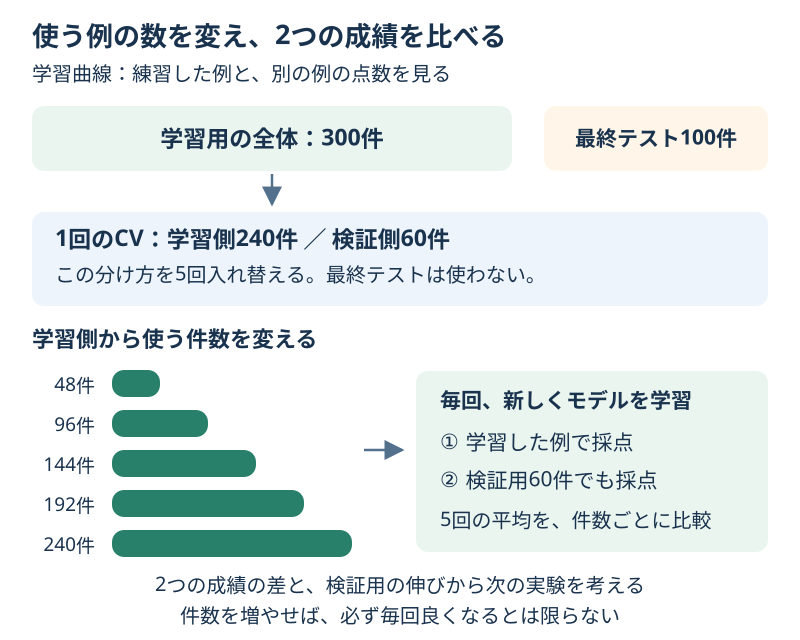

# Chapter 14: データを増やすと成績は変わる？

[学習の道順](../docs/learning-path.md) · 発展編（第5・7・10章の後がおすすめ）

## この章でわかること

使う例の数を変え、**練習した例と別の例の成績を並べる**「学習曲線」を読みます。
データを増やすか、モデルを変えるかを考える手がかりにします。

## 身近な例と図解

練習問題を10問、30問、50問と増やしたら、初めての問題も解けるようになるでしょうか？
練習した問題の点数だけでなく、毎回別の問題でも確かめる必要があります。



この章は、三日月の形をした2グループの人工データ400件を使います。
第7章の過学習のグラフと同じ種類の題材で、ここでは木の設定を固定し、学習する件数を変えます。

## 実行

```bash
.venv/bin/python scripts/ch14_learning_curves.py
```

Windowsは `.venv\Scripts\python.exe scripts/ch14_learning_curves.py` です。

## コードの読み方

| コード | していること |
| --- | --- |
| `train_test_split(..., test_size=0.25)` | 最終テスト100件を先に取っておく |
| `StratifiedKFold(n_splits=5, ...)` | 残り300件の中で、学習側240件と検証側60件を入れ替える |
| `train_sizes=[0.2, 0.4, ..., 1.0]` | 学習側240件の20%〜100%を使う |
| `learning_curve(model, X_train, y_train, ...)` | 件数ごとに新しく学習し、学習側と検証側を採点する |
| `training.mean(axis=1)` | 件数ごとに5回の学習側の成績を平均する |
| `validation.std(axis=1)` | 件数ごとに5回の検証側のばらつきを求める |

この例の学習件数は48・96・144・192・240件です。横軸の最大値は300ではありません。
毎回のCVで60件を検証用にするので、その回の学習側は最大240件です。
`shuffle=True`は学習側の順番を混ぜてから一部を選ぶ指定です。

## 結果の見方

出力例です。道具のバージョンによって小数が多少変わる場合があります。

| 1回の学習件数 | 学習用の平均 | 検証用の平均 |
| --- | --- | --- |
| 48 | 1.0000 | 0.8000 |
| 144 | 1.0000 | 0.8500 |
| 192 | 1.0000 | 0.8400 |
| 240 | 1.0000 | 0.8600 |

木は練習した例で満点でも、別の例では満点になっていません。
全体として検証用は良くなっていますが、144 → 192件では少し下がっています。
「データを増やすと必ず毎回良くなる」とは読まないようにします。

| 曲線の様子 | 次に試す候補 |
| --- | --- |
| 学習用は高く、検証用との間が大きい | モデルを簡単にする、設定を変える、追加データを集める |
| 学習用・検証用がともに低く、近い | 手がかりの見直し、表せる規則が異なるモデルを試す |
| 検証用が件数とともに上がっている | 追加データが役立つか、別の実験で確かめる |

これは次の実験の候補で、原因の断定ではありません。ラベルの間違いや分割方法も成績に関わります。
学習曲線は設定選びや改善を考える材料なので、最終テストはまだ使いません。

## グラフで見る

`scripts/visualize.py` で `outputs/figures/12_learning_curves.png` ができます。
横軸はCVの各回で学ぶ件数、縦軸は正解率です。2本の線の差と、検証用の伸びを見ます。
検証用の薄い帯は5回の平均 ± 標準偏差で、信頼区間ではありません。
英語なら `Training accuracy / Validation accuracy` は学習用／検証用の正解率です。

## まずはここだけ

表の48件と240件を比べ、学習用と検証用がそれぞれどう変わったか言ってみてください。
次に、144件と192件も比べます。一直線に良くなっていない点に注目します。

## 練習問題

1. 木の深さ3と上限なしを、同じ件数・同じCVで比べてください。
2. `train_sizes`を0.1刻みの10通りにし、件数ごとの表を作ってください。
3. 最大件数でのCVの平均が高いモデルを選び、学習用300件で学び直し、最終テストで1回確認してください。曲線の表を `outputs/learning_curves.csv` に保存します。

## ヒント

`curve_table(model, X_train, y_train, train_sizes=[count / 10 for count in range(1, 11)])` を使えます。
最後の行は `result.iloc[-1]` です。第10章と同じく、同率ならモデル名順で選びます。
学習曲線の中で学んだモデルは戻らないので、選んだモデルを `fit(X_train, y_train)` で学び直します。

## つまずいたとき

<details>
<summary>学習件数1.0なのに、300件すべてを使わない？</summary>

1.0はCVの「その回の学習側」の100%です。この例では300件のうち60件が検証側なので、学習側は240件です。
小さすぎる件数にすると片方の種類しか含まれない場合もあります。まずは用意した割合で試してください。

</details>

## この章のゴール

- [ ] 横軸が「CVの1回で学ぶ件数」だと説明できる。
- [ ] 学習用と検証用の成績の差から、次の実験を考えられる。
- [ ] 曲線を読む段階で、最終テストを使わずに残せる。

<details>
<summary>理解の確認：240件で86%なら、480件で100%になる？</summary>

この曲線だけでは言えません。伸びが止まったり、追加したデータの性質が違ったりする可能性があります。
倍の件数で満点になる、という比例関係ではありません。

</details>

[解答例](../answers/ch14_answer.py) · [前の章](ch13_csv_regression.md) · [次の章](ch15_imbalanced_classification.md) · [用語早見表](../cheatsheet.md) · [教材の入口](../README.md)

詳しい仕様は[learning_curveの公式説明](https://scikit-learn.org/stable/modules/generated/sklearn.model_selection.learning_curve.html)を参照してください。
