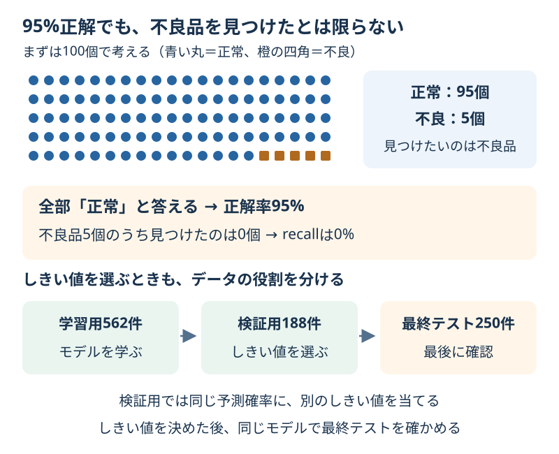

# Chapter 15: 少ない不良品を見つける

[学習の道順](../docs/learning-path.md) · 発展編（第3・4・5・6章の後がおすすめ）

## この章でわかること

見つけたい種類が少ない「不均衡な分類」を体験します。
**正解率が高いだけでは、少ない不良品を見つけたことにならない**と、件数で説明できるようになります。

## 身近な例と図解

100個の品のうち95個が正常なら、全部に「正常」と答えても95%正解します。
でも不良品5個はすべて見逃しています。何を見つけたいかによって、成績の読み方が変わります。



この章は4つの人工的な測定値を持つ1,000件のデータを使います。
0を正常、1を不良品と見立てた練習用で、実際の検査データではありません。
不良品の割合は約5%です。ラベルに偶然のずれも加えるので、ちょうど5%とは限りません。

## 実行

```bash
.venv/bin/python scripts/ch15_imbalanced_classification.py
```

Windowsは `.venv\Scripts\python.exe scripts/ch15_imbalanced_classification.py` です。

## コードの読み方

| コード | していること |
| --- | --- |
| `split_inspection_data()` | 学習用562件・設定選び用188件・最終テスト250件に分ける |
| `DummyClassifier(strategy="most_frequent")` | 最も多い「正常」をいつも答える基準を作る |
| `model.fit(X_train, y_train)` | 標準化と分類モデルを学習用だけから学ぶ |
| `model.predict_proba(X_valid)[:, 1]` | 不良品の予測確率を求める |
| `probabilities >= threshold` | しきい値以上なら不良品と判断する |
| `choose_threshold(result)` | 設定選び用でF1が最大のしきい値を選ぶ |

同率なら、しきい値が大きいほうを選ぶと事前に決めています。
しきい値を比べるときは、モデルや予測確率を学び直していません。最後も同じモデルを使います。
学習用と設定選び用は別です。最終テストは、しきい値も決まった後に1回だけ使います。

## 結果の見方

出力例では、設定選び用188件の中に不良品が10件あります。
全部を正常と答える基準は、178件を当て、正解率は約94.7%です。
一方、recallは0です。「本当の不良品10件のうち、拾えた数は0件」と読みます。

| 指標・件数 | 不良品検査での読み方 |
| --- | --- |
| precision | 不良品と判断した中で、本当に不良品だった割合 |
| recall | 本当の不良品のうち、見つけられた割合 |
| FN（見逃し） | 不良品を正常と判断した件数 |
| FP（誤検知） | 正常な品を不良品と判断した件数 |
| F1 | precisionとrecallをまとめた指標 |

同じ予測確率では、しきい値を下げると不良品と判断する範囲が広がります。
見逃しは増えませんが、誤検知は減りません。件数が変わらない範囲もあります。
この例ではF1で選びますが、検査の目的によっては見逃しや誤検知の負担を別に考えます。

precisionの分母が0、つまり不良品と判断した品がない場合、コードでは`zero_division=0`で0と表示します。
その場合は割合を計算できない状況なので、TP・FP・FNの件数も一緒に読みます。
設定選び用の不良品は10件だけです。そこで良かった成績が、最終テストでも同じになるとは限りません。

この例で選んだしきい値0.2の結果は、次のように読みます。数値は環境によって多少変わる場合があります。

| データの役割 | 本当の不良品 | 見つけたTP | 見逃したFN | recall |
| --- | --- | --- | --- | --- |
| 設定選び用 | 10件 | 9件 | 1件 | 0.9000 |
| 最終テスト | 13件 | 4件 | 9件 | 0.3077 |

最終テストでは約94%正解でも、不良品13件中9件を見逃しています。
高い検証成績から性能を決めつけず、この条件での最終結果として報告します。

## グラフで見る

`scripts/visualize.py` で `outputs/figures/13_imbalanced_classification.png` ができます。
左は正常と不良品の件数、右は設定選び用のしきい値ごとのprecision・recall・F1です。
最終テストの成績はこの比較グラフに入れません。
英語なら `Normal / Defective` は正常／不良品、`Decision threshold` はしきい値です。

## まずはここだけ

最初の基準のaccuracyとrecallを見て、「94.7%当たったのに何をできていないか」を1文で言ってください。
次に、しきい値の表のFN列を見て、見逃した件数を比べます。

## 練習問題

1. 正常だけを答える基準のaccuracy・recallと、見逃した不良品の件数を表示してください。
2. しきい値に0.1・0.3を加え、設定選び用のF1で選んでから、最終テストで1回確認してください。
3. 候補の比較表を `outputs/threshold_comparison.csv` に保存し、しきい値を下げたときのFP・FNの変化を説明してください。

## ヒント

`threshold_table(y_valid, probabilities, thresholds=[0.1, 0.2, 0.3, 0.5, 0.8])` を使えます。
最終テストには、選んだしきい値1つを `metrics_at_threshold(...)` に渡します。
FNは見逃し、FPは誤検知です。下げる前後で同じ予測確率を使っていることも確認します。

## つまずいたとき

<details>
<summary>しきい値を変えても件数が同じ／不良品を増やしてから分割してもいい？</summary>

2つのしきい値の間に予測確率の値がなければ、判断は変わりません。エラーではありません。
同じ行をコピーして不良品を増やしてから分割すると、同じ品が学習側と確認側に入るおそれがあります。
この章では元のデータの割合を保って分け、しきい値だけを比較します。

</details>

## この章のゴール

- [ ] 正解率が高くても少ない対象を見逃す例を、件数で説明できる。
- [ ] しきい値によるFP・FNの変化を読める。
- [ ] 学習用・設定選び用・最終テストの役割を分けられる。

<details>
<summary>理解の確認：最終テストのrecallが低かったから、しきい値を下げて採点し直す？</summary>

それをすると、最終テストもしきい値の選び方に使ったことになります。
改良するなら次の実験として行い、別の評価データを用意します。今回の最終結果は、選んだ条件のまま報告します。

</details>

[解答例](../answers/ch15_answer.py) · [前の章](ch14_learning_curves.md) · [次の章](ch16_feature_importance.md) · [第4章の混同行列](ch04_metrics.md) · [教材の入口](../README.md)

詳しい考え方は[しきい値選びの公式説明](https://scikit-learn.org/stable/modules/classification_threshold.html)を参照してください。
