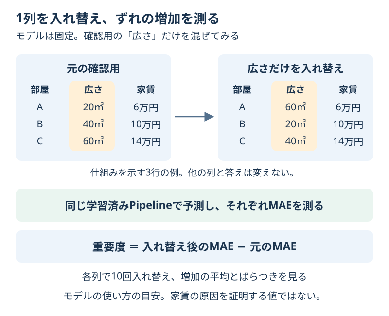

# Chapter 16: モデルが使う手がかりを調べる

[学習の道順](../docs/learning-path.md) · 発展編（第2・5・6・13章の後がおすすめ）

## この章でわかること

予測に使う列を1つずつ入れ替え、**そのモデルがどの手がかりに頼っているか**を調べます。
「Permutation Importance（入れ替えによる重要度）」を、家賃のずれの増加として読みます。

## 身近な例と図解

部屋一覧の「広さ」の列だけ、別の部屋の値と入れ替えたら、家賃の予想はどうなるでしょうか？
広さと家賃の対応が崩れて成績が悪くなるなら、モデルは広さを予測に使っていると考えられます。



第13章の120件の架空の家賃CSVと、前処理を含む回帰モデルを使います。
ここでは改良の手がかりとして調べるので、確認用のほかに、最終テストを別に残します。

## 実行

```bash
.venv/bin/python scripts/ch16_feature_importance.py
```

Windowsは `.venv\Scripts\python.exe scripts/ch16_feature_importance.py` です。

## コードの読み方

| コード | していること |
| --- | --- |
| `split_rooms()` | 学習用67件・調べるための確認用23件・最終テスト30件に分ける |
| `build_model().fit(X_train, y_train)` | 前処理と回帰を、学習用だけから学ぶ |
| `mean_absolute_error(...)` | 入れ替える前の予測のずれを測り、単純な基準とも比べる |
| `permutation_importance(model, X_inspect, y_inspect, ...)` | 確認用の元の4列を1列ずつ入れ替え、成績の変化を測る |
| `n_repeats=10` | 列ごとに10通りの入れ替えを行う |
| `result.importances_mean / importances_std` | ずれの増加の平均／ばらつきを読む |

入れ替えるたびにモデルを学び直すわけではありません。同じ学習済みモデルを使います。
文字を変換した後の列ではなく、入力の「広さ」「時間」「築年数」「地域」の4列を調べます。
地域の列には文字も空欄もありますが、Pipeline全体を渡すことで、学習済みの前処理も同じように使えます。

## 結果の見方

出力例です。道具のバージョンによって小数が多少変わる場合があります。

| 手がかり | MAE増加の平均（万円） | 入れ替えによるばらつき |
| --- | --- | --- |
| 広さ `area_sqm` | 1.935 | 0.384 |
| 地域 `zone` | 0.469 | 0.107 |
| 駅からの時間 `walk_min` | 0.295 | 0.072 |
| 築年数 `age_years` | 0.188 | 0.069 |

元の確認用MAEは約0.73万円です。広さを入れ替えると、MAEが平均でさらに約1.94万円増えます。
1.94万円が入れ替え後のMAE全体ではありません。**入れ替え後のMAE − 元のMAE**です。
採点名は第13章と同じ `neg_mean_absolute_error`ですが、重要度の計算ではマイナスの差が打ち消され、この「MAEの増加」になります。
返された重要度に、さらにマイナスを付けないでください。

| 値 | 読み方 |
| --- | --- |
| 大きなプラス | 入れ替えると成績が悪くなる。このモデルが頼っている手がかりの目安 |
| 0に近い | このモデルと確認用では、入れ替えによる変化が小さい |
| マイナス | 入れ替えたほうが良かった。ばらつきやモデルの使い方も確認する |

モデル自体がうまく予測しているか、まず単純な基準と比べます。
入力を使わないモデルの重要度が低くても、手がかり自体が役に立たないとは言えません。
似た情報を持つ列が2つあると、片方を入れ替えてももう片方が補い、重要度が小さく見えることもあります。
重要度は、このモデルとデータでの予測の目安です。実際の家賃の原因や、すべての地域での順位を示す値ではありません。

## グラフで見る

`scripts/visualize.py` で `outputs/figures/14_feature_importance.png` ができます。
横軸はMAEの増加（万円）、棒は10回の平均、横線は標準偏差です。線は信頼区間ではありません。
英語なら `Increase in MAE (10,000 JPY)` はMAEの増加（万円）、`Area / Zone / Walk time / Age` は広さ／地域／駅からの時間／築年数です。

## まずはここだけ

広さの重要度と、入れ替える前のMAEを足して、おおよその入れ替え後MAEを求めてください。
「1.94万円ずれる」と「ずれが1.94万円増える」の違いを言ってみます。

## 練習問題

1. 入れ替える回数を30回に増やし、平均とばらつきを比べてください。ばらつきが必ず小さくなるとは限りません。
2. いつも平均を答える `DummyRegressor`でも重要度を調べ、入れ替え前のMAEと合わせて比べてください。
3. 比較表を `outputs/feature_importance.csv` に保存し、「広さの重要度が大きい」から言えること・言えないことを1文ずつ書いてください。

## ヒント

`importance_table(model, X_inspect, y_inspect, n_repeats=30)` を使えます。
単純な基準も、同じ `X_train, y_train` で学習し、同じ確認用で調べます。
基準の予測は入力に関係なく同じ値です。列を入れ替えても変わるか考えてみてください。

## つまずいたとき

<details>
<summary>入れ替え前のMAEより重要度が大きい／マイナスが出たらエラー？</summary>

重要度はMAEの増加なので、元のMAEより大きくなることもあります。
マイナスもエラーではありません。確認用の件数や入れ替えのばらつきを見ます。
入力列を削るなどの判断に使うなら、最終テストを使わず、別の比較実験で確かめてください。

</details>

## この章のゴール

- [ ] 入れ替える前後のMAEの差として、重要度を読める。
- [ ] モデルを固定し、確認用の1列だけを入れ替える手順を説明できる。
- [ ] 重要度を、原因の証明や手がかりの絶対的な順位と区別できる。

<details>
<summary>理解の確認：平均を答える基準の重要度が全部0なら、広さは無意味？</summary>

その基準が広さを使っていないことを示しています。手がかり自体が無意味という意味ではありません。
使うモデルによって、同じ列でも重要度は変わります。

</details>

[解答例](../answers/ch16_answer.py) · [前の章](ch15_imbalanced_classification.md) · [総合課題](../docs/capstone.md) · [第13章の家賃CSV](ch13_csv_regression.md) · [教材の入口](../README.md)

詳しい定義と注意点は[Permutation Importanceの公式説明](https://scikit-learn.org/stable/modules/permutation_importance.html)を参照してください。
