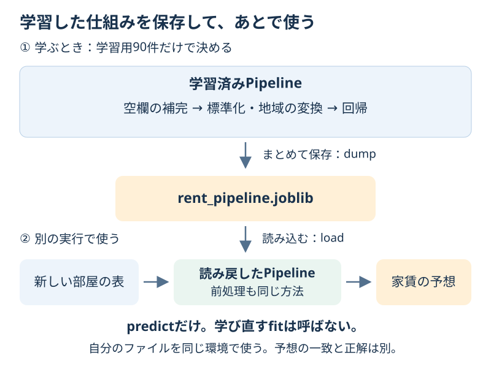

# Chapter 17: モデルを保存して、あとで使う

[学習の道順](../docs/learning-path.md) · 発展編（第6・13章の後がおすすめ）

## この章でわかること

学習したモデルをファイルに保存し、別の実行で**学び直さずに予想する**方法を学びます。
空欄の埋め方や文字の変換も含めて、Pipeline全体を保存します。

## 身近な例と図解

料理のたびにレシピを考え直す代わりに、決めたレシピをノートに残して使うイメージです。
モデルも、学習した内容をファイルに残せます。保存した内容は、新しいデータを渡すだけで変わりません。



第13章の架空の家賃CSVを使います。保存するのは「元のデータのコピー」ではなく、
空欄を埋める中央値や標準化の尺度、地域の変換方法、回帰の係数などを持つ学習済みの仕組みです。

## 実行

次を1行ずつ実行します。2行目は別のPythonの実行です。

```bash
.venv/bin/python scripts/ch17_model_persistence.py
.venv/bin/python scripts/predict_saved_rent.py
```

Windows:

```powershell
.venv\Scripts\python.exe scripts/ch17_model_persistence.py
.venv\Scripts\python.exe scripts/predict_saved_rent.py
```

`outputs/rent_pipeline.joblib` と `outputs/rent_metadata.json` ができます。
1行目を再実行すると、この練習用ファイルを上書きします。2行目は読み込んで予測するだけです。

## コードの読み方

| コード | していること |
| --- | --- |
| `train_rent_model()` | 第13章と同じ学習用90件だけからPipelineを学ぶ |
| `joblib.dump(model, model_path)` | 学習済みの前処理と回帰をまとめて保存する |
| `joblib.load(model_path)` | 自分が保存したファイルを読み戻す |
| `restored.predict(rooms)` | 学習時に決めた前処理を使い、新しい部屋を予想する |
| `np.allclose(before, after)` | 保存前後で予測の数値が一致するか、小さな計算誤差を許して確認する |
| `rent_metadata.json` | 入力の列・答えの単位・使った道具のバージョンを記録する |

読み込み後に `fit` を呼ぶと、新しく学び直すことになります。
**予測だけなら `predict`** です。回帰の部分だけを保存すると、空欄や地域の文字を扱う準備が足りなくなります。

この章では、自分で作ったファイルを同じPython環境で読み込みます。
`joblib.load` は読み込み時にコードを実行できる形式なので、出所を信頼できないファイルは読み込まないでください。
異なるバージョンでの読み込みは保証されません。JSONの環境メモは再現の手がかりであり、安全性や互換性を保証する検査ではありません。

## 結果の見方

| 新しい部屋 | 保存前の予想 | 読み込み後の予想 |
| --- | --- | --- |
| 35㎡・駅から8分・築10年・suburb（郊外） | 約8.14万円 | 約8.14万円 |
| 同じ部屋で駅からの時間が空欄 | 約7.72万円 | 約7.72万円 |
| 同じ部屋で地域がcoastal（学習時にない値） | 約8.86万円 | 約8.86万円 |

2行目は、保存されている学習用の中央値で空欄を埋めています。
3行目は `handle_unknown="ignore"` により、学習済みの地域の列をすべて0にして計算します。
coastalの家賃を学んだわけではありません。新しい地域でも正しく予測できるかは、別に確かめる必要があります。

`予想は一致した？ True` は保存・読み込みができた確認です。
**予想が一致することと、予想が当たることは別**です。新しい3部屋の正解の家賃がないので、MAEはまだ計算できません。
最初に表示する約0.69万円のMAEは、第13章と同じ最終テスト30件での成績です。

## まずはここだけ

[予測だけのコード](../scripts/predict_saved_rent.py)を開き、`fit` がないことを確認します。
2回実行し、予想が変わらない理由を説明してください。

## 練習問題

1. `example_rooms()` の3件を使い、保存前・読み込み後の予測が一致するか確認してください。
2. 空欄と未知の地域を扱える理由を、前処理の名前と結びつけて説明してください。
3. メタデータで列名・単位・バージョンを確認し、予測の比較表を `outputs/answer17/rent_roundtrip.csv` に保存してください。新しい部屋のMAEをまだ計算できない理由も書きます。

## ヒント

[解答](../answers/ch17_answer.py)は単独でも実行できるよう、`outputs/answer17/` に自分のモデルを作ってから読み込みます。
そのフォルダのモデルを別の実行で使うなら、次のように指定できます。

```bash
.venv/bin/python scripts/predict_saved_rent.py --model-path outputs/answer17/rent_pipeline.joblib
```

Windowsは先頭を `.venv\Scripts\python.exe` にします。
モデルの保存先を変えるときは、第17章のコマンドに `--output-dir outputs/my_model` を付けます。

## つまずいたとき

<details>
<summary>モデルが見つからない／必要な列がないと言われる</summary>

先に第17章を実行してください。保存先を変えた場合は `--model-path` で同じファイルを指定します。
入力の列は `area_sqm`・`walk_min`・`age_years`・`zone` です。列の不足と、その列の値の空欄は別です。
広さを坪で渡すなど、単位を変えると数字の意味も変わります。メタデータの記録と第13章の列の説明を確認します。

</details>

## この章のゴール

- [ ] 前処理を含めたPipelineを保存し、別の実行で使える。
- [ ] 保存前後の一致と、未知の部屋での精度を区別できる。
- [ ] 読み込めるファイルの出所と、入力の列・単位・環境を確認できる。

<details>
<summary>理解の確認：予測するたびにfitし直す？</summary>

保存された学習結果で予測するだけなら、fitはしません。新たな学習は、予測とは別の作業です。

</details>

[解答例](../answers/ch17_answer.py) · [前の章](ch16_feature_importance.md) · [次の章](ch18_text_classification.md) · [用語早見表](../cheatsheet.md) · [教材の入口](../README.md)

形式と環境の詳しい説明は[モデル保存の公式説明](https://scikit-learn.org/stable/model_persistence.html)を参照してください。
