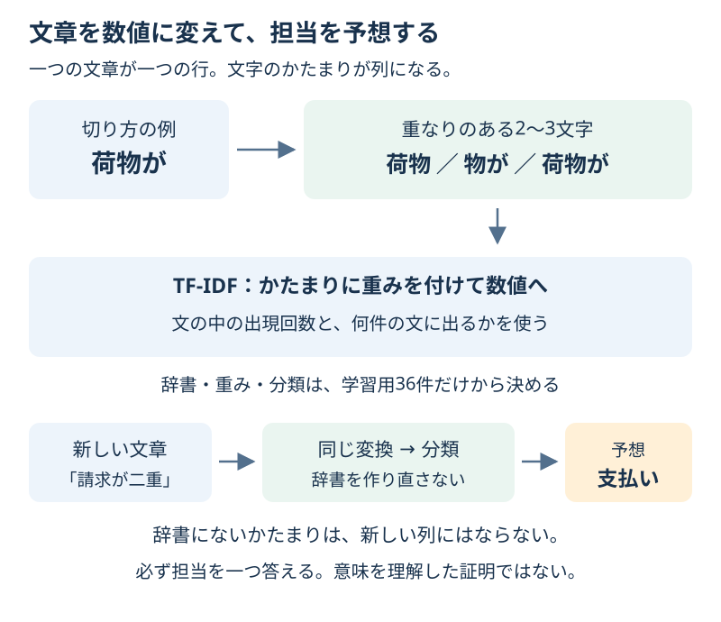

# Chapter 18: 日本語の問い合わせを分類する

[学習の道順](../docs/learning-path.md) · 発展編（第3・4・5・6章の後がおすすめ）

## この章でわかること

文章を数値の手がかりに変え、**問い合わせを「配送」「支払い」に分ける**流れを学びます。
日本語の文字のかたまりを使うので、追加の辞書や外部データのダウンロードは必要ありません。

## 身近な例と図解

「荷物が届かない」は配送担当、「請求が二重」は支払い担当に案内したい、という場面です。
文章にも、分類の手がかりを見つけられます。



教材用に書いた48件の架空の問い合わせを使います。配送24件・支払い24件です。
実際の顧客の文章は使っていません。この小さな例で当たっても、現実の問い合わせで使えるとまでは言えません。

## 実行

```bash
.venv/bin/python scripts/ch18_text_classification.py
```

Windowsは `.venv\Scripts\python.exe scripts/ch18_text_classification.py` です。

## コードの読み方

| コード | していること |
| --- | --- |
| `split_messages()` | 各種類の割合を保ち、学習用36件と最終テスト12件に分ける |
| `TfidfVectorizer(analyzer="char", ngram_range=(2, 3))` | 重なりのある2文字・3文字を数値にする |
| `Pipeline([...])` | 文章の変換と分類を一つにまとめる |
| `model.fit(X_train, y_train)` | 学習用の文章だけで辞書・重み・分類規則を学ぶ |
| `model.predict(X_test)` | 同じ辞書と重みで、初めての文章を予想する |
| `f1_score(..., average="macro")` | 種類ごとに計算したF1を、同じ重みで平均する |

`X` は1件ずつの文章、`y` は担当を示す `shipping`（配送）か `payment`（支払い）です。
第3章の花の分類と同じく、入力から種類を一つ予想します。

### 文章が数値になるまで

1. 「荷物が」を2文字なら「荷物」「物が」、3文字なら「荷物が」に切ります。これが文字の **n-gram** です。
2. 学習用で見つかったかたまりを辞書の列にします。文章1件が1行になります。
3. **TF-IDF** は、文章内での出現回数と、学習用の何件に現れるかを使って重みを付けます。多くの文章に共通するかたまりの重みを抑え、さらに行ごとの尺度を整えます。

出てこないかたまりの値は0です。辞書にないかたまりは、予測時に新しい列として追加されません。
この数値は、感情の強さや「配送らしさの確率」ではありません。**文字を単語の意味ごとに切っているわけでもありません。**
数値の表と担当の答えから、LogisticRegressionが分類を学びます。

最終テストを混ぜて先に辞書や重みを作ると、確認用の情報を先に見たことになります。
CVで切り方を選ぶときも、変換を含むPipelineを各分割の中で学びます。

## 結果の見方

サンプルの出力例です。小数はバージョンによって多少変わる場合があります。

| 方法 | 正解率 | macro F1 |
| --- | --- | --- |
| いつも同じ種類を答える基準 | 0.500 | 0.333 |
| 2〜3文字から学ぶモデル | 1.000 | 1.000 |

ここではテストの12件すべてが正解しています。12件という小さな教材の結果です。
正解率1.000は、別の言い回し・誤字・複数の話題にも必ず対応できるという意味ではありません。

4マスの表は、行が実際の担当、列が予想した担当で、順番は配送・支払いです。
対角線の6と6は当たった件数、残りの0と0は間違いです。読み方は[第4章](ch04_metrics.md)と同じです。

解答では1文字と2〜3文字を、学習用の同じ3分割で比べます。CVのmacro F1は約0.739と約0.250で、1文字が選ばれます。
選んだ1文字の最終テストは約0.917です。**この結果を見て、サンプルの2〜3文字へ選び直しません。**
36件をさらに分けると各回の学習用は24件です。小さなデータでは、分割や言い回しによって結果が大きく変わることも学びます。

「送料を返金してほしいです」のような文は、配送と支払いの両方に関係します。
このモデルは、どんな文章にも二つの担当のどちらかを答えます。自動で正しい担当へ回せるか、二つの担当で確認すべきかは、別の判断です。

## グラフで見る

`scripts/visualize.py` で `outputs/figures/15_text_classification.png` ができます。
左は最終テストの4マス、右は新しい3文の「荷物」「配達」「請求」「返金」のTF-IDFの値です。
右は学習用で作った辞書を使って変換するだけで、学び直しません。色は分類の確信度ではありません。
英語なら `Actual / Predicted` は答え／予想、`Shipping / Payment` は配送／支払いです。
右の列 `Parcel / Delivery / Billing / Refund` はそれぞれ「荷物／配達／請求／返金」のかたまりを表します。

## まずはここだけ

「請求書」を2文字・3文字に切ると何ができますか？ `build_analyzer()('請求書')` で確認してください。
文章を変えたとき、数値のどの列が変わりそうか予想します。

## 練習問題

1. 1文字 `(1, 1)` と2〜3文字 `(2, 3)` を、学習用だけの同じ3分割CVで比べてください。macro F1の平均が高い設定を選び、最終テストを一度だけ評価します。同点なら先の候補にします。
2. 選んだモデルの最終テストの文章・答え・予想を `outputs/text_predictions.csv` に保存し、間違いの行を見てください。間違いがなければ、確認した件数も記録します。
3. 二つの話題を含む「送料を返金してほしいです」「届いた商品の請求金額が違います」を予測してください。一つのラベルでは足りない理由と、人が確認する方法を考えます。

## ヒント

`build_model((1, 1))` と `build_model((2, 3))` を使います。
`StratifiedKFold(n_splits=3, shuffle=True, random_state=42)` の分割を一度作り、両方に渡します。
`scoring="f1_macro"` は大きいほど良い指標です。全体の正解率と、種類ごとのF1の平均は別の値です。

## つまずいたとき

<details>
<summary>辞書の列が多い／短い文でも必ず担当が出る</summary>

2〜3文字のかたまりをたくさん見つけるので、元の文章の件数より列が多くなります。
ほとんどの値は0なので、道具は0を省いて持つ「疎な行列」を使います。全部を画面に並べる必要はありません。
知らない文字だけの文では手がかりが0になることもあります。それでもこの分類器は一つのラベルを返します。
返されたラベルだけで、文章を理解できた・判断してよいとは言えません。

</details>

## この章のゴール

- [ ] 文章を文字のかたまりと数値に変える流れを説明できる。
- [ ] 辞書と重みも、学習用だけから作ることを説明できる。
- [ ] 少ないテストでの高い成績と、曖昧な文章への対応を区別できる。

<details>
<summary>理解の確認：予測用の文章に新しいかたまりがあったら、辞書を増やす？</summary>

増やしません。学習した辞書と同じ列で予測します。辞書を変えて学び直すのは、別の学習です。

</details>

[解答例](../answers/ch18_answer.py) · [前の章](ch17_model_persistence.md) · [次の章](ch19_time_series.md) · [用語早見表](../cheatsheet.md) · [教材の入口](../README.md)

詳しい変換は[TfidfVectorizerの公式説明](https://scikit-learn.org/stable/modules/generated/sklearn.feature_extraction.text.TfidfVectorizer.html)を参照してください。
