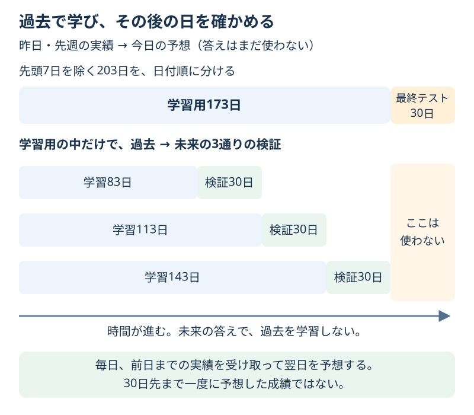

# Chapter 19: 時間の順番を守って予測する

[学習の道順](../docs/learning-path.md) · 発展編（第2・5・6章の後がおすすめ。設定選びは第11章も参考）

## この章でわかること

毎日の販売個数を題材に、**過去を使って、その後の1日を予想する**手順を学びます。
日付があるデータでは、ランダムに混ぜる分割が目的に合わないことがあります。

## 身近な例と図解

お店で「明日は何個売れるだろう」と考えるとき、今日までの売れ方は使えます。
明日の実際の個数や、来週の実績を先に知ることはできません。



2025年1月1日から210日分の架空の販売個数をコードで作ります。
毎日1行、欠けた日がないデータです。曜日の波とゆるやかな増加に、偶然のずれを加えています。
実際のお店の需要を示すデータではありません。

## 実行

```bash
.venv/bin/python scripts/ch19_time_series.py
```

Windowsは `.venv\Scripts\python.exe scripts/ch19_time_series.py` です。

## コードの読み方

| コード | していること |
| --- | --- |
| `make_sales()` | 日付順の架空の販売個数を作る |
| `sales.shift(1)` | 昨日の個数を、今日の行へ移す |
| `sales.shift(7)` | 7日前の個数を、今日の行へ移す |
| `make_features(sales)` | 日数・曜日・過去の個数を手がかりの表にする |
| `X.iloc[:-30] / X.iloc[-30:]` | 古い173日を学習用、最後の30日を最終テストにする |
| `TimeSeriesSplit(n_splits=3, test_size=30)` | 学習用の中で、過去で学び、その後の30日で確かめる |
| `StandardScaler()` と `Ridge(alpha=1)` | 学習用で数値の尺度を整え、販売個数の回帰を学ぶ |

**ラグ**は、過去の値を手がかりとして移した列です。`lag_1` は昨日、`lag_7` は先週の同じ曜日です。
たとえば今日が7月1日なら、`lag_1` は6月30日、`lag_7` は6月24日の実績です。
今日の販売個数は `y` であり、今日の `X` には入れません。先週の値がない最初の7日は除きます。

曜日を二つの数値 `weekday_sin / weekday_cos` にするのは、日曜と月曜も隣り合う、週の輪を表すためです。
最初は「曜日を伝える二つの手がかり」と読めば大丈夫です。日数 `day_index` と曜日は、予想する日になる前からわかります。

### この予測で、いつ何がわかる？

| 予想する日 | 使える最新の実績 | まだ使えない答え |
| --- | --- | --- |
| 6月30日 | 6月29日までの個数 | 6月30日の個数 |
| 7月1日 | 6月30日までの個数 | 7月1日の個数 |
| 7月2日 | 7月1日までの個数 | 7月2日の個数 |

この教材の条件は、閉店後にその日の実績を受け取り、翌日の個数を予想することです。
コードは表を一度に作りますが、各行のラグには、その行より前の日の実績しか入りません。
テスト2日目以降には、その前のテスト日の実績も使います。その時点で観測済みという条件だから使えます。
モデルの係数は学習用で固定し、テスト中に学び直しません。

**30日先まで一度に予想する条件では、途中の実績はまだわかりません。**
その場合、この表のまま採点すると目的が変わります。何日先の予想なのかを先に決めることが大切です。

## 結果の見方

| 方法 | 最終テスト30日のMAE |
| --- | --- |
| 昨日と同じ個数を答える基準 | 約11.73個 |
| サンプルのモデル（alpha=1） | 約4.83個 |

MAEが4.83個なら、毎日の予想のずれの大きさが平均で約4.83個、という意味です。
毎日ちょうど4.83個ずれるわけではなく、大きく外れる日もあります。
また、どちらも「前日までの実績を使った翌日分の予想」です。別のお店や長い予測期間での精度は、この結果からはわかりません。

表示する時間順のCVは次の3通りです。サンプルでは分割を表示し、設定比較は解答で行います。

| 回 | 学習用の日数・最後の日 | 検証用の日数・最初の日 |
| --- | --- | --- |
| 1 | 83日・3月31日 | 30日・4月1日 |
| 2 | 113日・4月30日 | 30日・5月1日 |
| 3 | 143日・5月30日 | 30日・5月31日 |

どの回も学習は検証より古く、最後の30日のテストは入りません。
解答では同じ3分割でalphaを選び、選んだ設定で学習用全体から学んだ後、最終テストを一度だけ確かめます。
CVで選ぶalpha=10の最終MAEは約4.95個です。サンプルより小さくなくても、テストを見て選び直しません。

この `TimeSeriesSplit` は行の順番で区切ります。入力はあらかじめ日付順である必要があります。
同じ日数の成績を比べるため、この例では毎日1行を揃えています。欠けた日や複数店舗がある表には、目的に合った準備が必要です。

## グラフで見る

`scripts/visualize.py` で `outputs/figures/16_time_series.png` ができます。
上は全期間の実際の個数と学習・テストの境目、下はテスト30日の答え・予想・昨日と同じ基準です。
どの日に大きく外れたか、線を見比べます。薄い色の部分は最終テストです。
英語なら `Daily sales (items)` は毎日の販売個数、`Actual / Model / Yesterday` は答え／モデル／昨日と同じ基準です。

## まずはここだけ

テスト最初の2行の `lag_1` を見て、どの日の個数か確認してください。
2行目にテスト1日目の実績を使えるのは、どんな予測条件だからか説明します。

## 練習問題

1. 同じ時間順の3分割CVで `alpha=0.1, 1, 10` を比べ、平均MAEが小さい設定を選んでください。同点なら先の候補です。選んだ設定で、最後の30日を一度だけ評価します。
2. 最終テストの同じ30日で、選んだモデル・昨日と同じ基準・先週と同じ基準のMAEを比べてください。
3. 日付・答え・予想・二つの基準を `outputs/sales_predictions.csv` に保存し、「毎日翌日を予想」と「30日先まで一度に予想」の違いを1文で書いてください。

## ヒント

`chronological_folds(X_train)` の分割を全候補に渡し、前処理を含むPipelineをCVで比べます。
`scoring="neg_mean_absolute_error"` の平均にマイナスを付け、普通のMAEへ戻します。小さいほど良い値です。
先週と同じ基準は `X_test["lag_7"]` です。

## つまずいたとき

<details>
<summary>先頭に空欄ができた／shuffle=Trueにしてよい？</summary>

最初の7日には、表の中に先週の値がないため空欄ができます。この教材ではその7日を除きます。
未来を予想する評価なので、日付を混ぜません。未来の答えを学習して過去を採点すると、実際に予想するときの条件と違ってしまいます。
自分の表を使う場合、`shift(7)` は「7行前」です。1行が1日でなければ、必ずしも7日前ではありません。

</details>

## この章のゴール

- [ ] 今日の答えを、今日の手がかりに入れずにラグを作れる。
- [ ] 学習する日が検証・テストの日より古い分割を説明できる。
- [ ] 何日先を予想し、いつ実績を受け取るかを説明できる。

<details>
<summary>理解の確認：時間順に分ければ、どんな列でも使ってよい？</summary>

よくありません。日付の分割と、手がかりが予測時点でわかるかの確認は、両方必要です。
当日の実際の販売個数や、未来の値を平均した列を入れると、この予測条件では漏洩になります。

</details>

[解答例](../answers/ch19_answer.py) · [前の章](ch18_text_classification.md) · [総合課題](../docs/capstone.md) · [用語早見表](../cheatsheet.md) · [教材の入口](../README.md)

分割の定義は[TimeSeriesSplitの公式説明](https://scikit-learn.org/stable/modules/generated/sklearn.model_selection.TimeSeriesSplit.html)、
過去の値の使い方は[ラグを使った予測の公式例](https://scikit-learn.org/stable/auto_examples/applications/plot_time_series_lagged_features.html)を参照してください。
