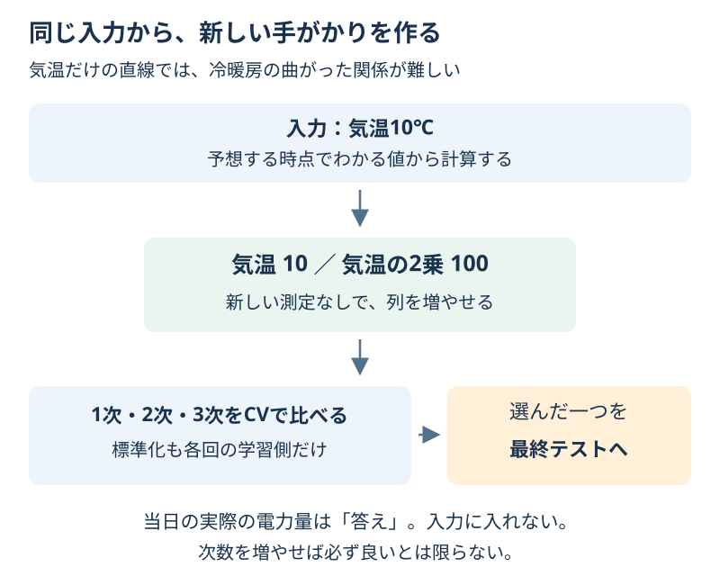

# Chapter 20: 手がかりの作り方を変える

[学習の道順](../docs/learning-path.md) · 発展編（第2・5・6・11章の後がおすすめ）

## この章でわかること

同じ測定値から新しい列を作る**特徴量エンジニアリング**を学びます。気温と電力量の架空の例で、直線だけでは表せない曲がった関係を、気温の2乗で表します。

## 身近な例と図解

暖房は寒い日に、冷房は暑い日に使います。気温が高いほど電力量がいつも増える、という直線だけでは、この形を表しにくそうです。



320件の架空データです。1行は1日の例、入力は気温（℃）、答えは電力量（kWh）です。実際の気象や電力のデータ・計算式ではありません。

## 実行

```bash
.venv/bin/python scripts/ch20_feature_engineering.py
```

Windowsは `.venv\Scripts\python.exe scripts/ch20_feature_engineering.py` です。

## コードの読み方

| コード | していること |
| --- | --- |
| `X_train.describe()` | 学習用の気温の件数・範囲・平均などを確認する |
| `PolynomialFeatures(degree=2, include_bias=False)` | 気温と気温の2乗を2列にする |
| `StandardScaler()` | 新しい列の尺度を、各回の学習側だけで整える |
| `Ridge(alpha=0.1)` | 係数を大きくしすぎない工夫のある回帰を学ぶ |
| `compare_degrees(...)` | 学習用240件の同じ5分割CVで次数を比べる |
| `choose_degree(table)` | CVのMAEが小さい次数を選ぶ。同点なら小さい次数 |

気温10℃なら、2次の入力は「10、100」です。電力量の答えを使って列を作るのではありません。1次なら元の気温だけ、3次なら3乗も加えます。

列を増やした後も、Ridgeは列に係数を掛けて足します。元の気温から見ると、2乗の列があるので曲線を表せます。**線形モデルという名前でも、元の入力に対する形を曲げられる**例です。

次数を増やすと複雑な形も表せますが、偶然のずれに合わせすぎることもあります。入力が増えると列の数も大きくなるので、CVで確かめます。実際の値を受け取る前に作れる手がかりかも確認します。

## 結果の見方

次は出力例です。道具のバージョンによって小数などが変わる場合があります。

| 次数 | 学習用CVのMAE（kWh） |
| --- | --- |
| 1 | 約1.919 |
| 2 | 約0.203 |
| 3 | 約0.204 |

この例では2次が選ばれます。別の最終テスト80件では約0.206kWh、平均を答える基準は約3.128kWhです。
曲がった関係を持つよう作った例であり、別の題材でも2次がよいという結論ではありません。

## グラフで見る

`scripts/visualize.py` で `outputs/figures/17_feature_engineering.png` ができます。
左は学習用CVのMAE、右は直線と選んだ次数の予想です。点は最終テストの答えです。右のグラフを見て次数を選び直しません。
英語の `Degree / Temperature / Energy` は次数／気温／電力量です。

## まずはここだけ

0℃・10℃・20℃を2次の入力に変え、元の気温と2乗を紙に書いてください。答えの電力量をまだ知らなくても作れるか確認します。

## 練習問題

1. 3次の入力を表示し、列名と数値を確認してください。
2. 4次を候補に加え、学習用だけの同じCVで選んだ一つを、最終テストで確認してください。
3. CVの比較表を `outputs/feature_degrees.csv` に保存し、予測時に作れる列と、作ってはいけない答え由来の列を1つずつ書いてください。

## ヒント

`build_model(3).named_steps["features"]` と `get_feature_names_out()` を使えます。`compare_degrees(..., degrees=(1, 2, 3, 4))` は同じ5分割を候補に渡します。

## つまずいたとき

<details>
<summary>気温の2乗は単位が変わる／次数を上げるほど成績がよい？</summary>

2乗の列は元の気温とは違う尺度です。そのため列を作った後に標準化します。次数を増やしても、検証の成績が良くなるとは限りません。観測した範囲から遠い気温への予想にも注意します。

</details>

## この章のゴール

- [ ] 入力だけから、予測時に作れる手がかりを説明できる。
- [ ] 直線の回帰と、2乗を使った曲線の関係を説明できる。
- [ ] 列を増やす判断に、学習用だけのCVを使える。

<details>
<summary>理解の確認：当日の実際の電力量を10分の1にした列なら、手がかりに入れてよい？</summary>

よくありません。加工しても、予想したい答えを先に使っていることは同じです。

</details>

[解答例](../answers/ch20_answer.py) · [前の章](ch19_time_series.md) · [次の章](ch21_group_validation.md) · [用語早見表](../cheatsheet.md) · [教材の入口](../README.md)

詳しくは[PolynomialFeaturesの公式説明](https://scikit-learn.org/stable/modules/generated/sklearn.preprocessing.PolynomialFeatures.html)を参照してください。
