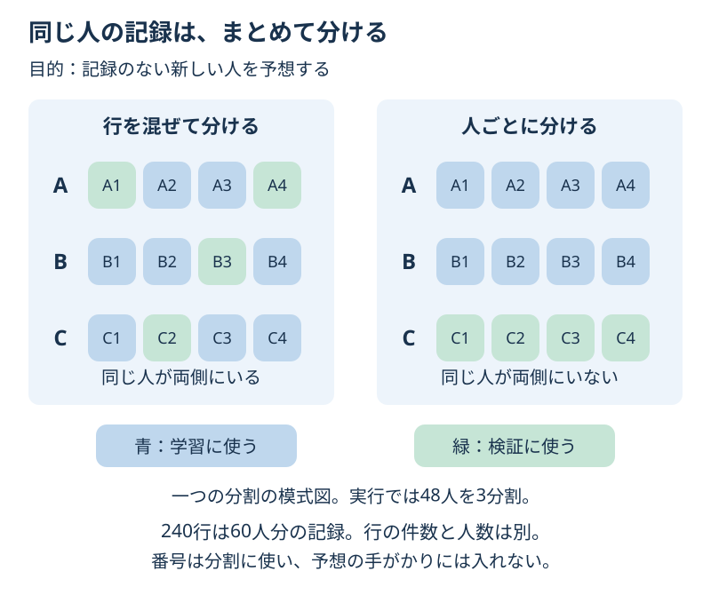

# Chapter 21: 同じ人の記録をまとめて分ける

[学習の道順](../docs/learning-path.md) · 発展編（第5・7・10章の後がおすすめ）

## この章でわかること

一人に何行もあるデータで、**人ごとに分けるグループ分割**を学びます。行の数と、独立した人の数を区別します。

## 身近な例と図解

同じ生徒の4回の記録があります。3回の記録を見た人の残り1回を当てるのと、まだ記録のない人を当てるのでは、難しさが違います。



60人が4回ずつ持つ、240行の架空の記録です。練習時間と小テストの値は人ごとに固定し、次の点数にはその人固有のずれと小さな偶然のずれを加えています。現実の生徒の能力や学校の評価を表すものではありません。

## 実行

```bash
.venv/bin/python scripts/ch21_group_validation.py
```

Windowsは `.venv\Scripts\python.exe scripts/ch21_group_validation.py` です。

## コードの読み方

| コード | していること |
| --- | --- |
| `student_id` | 同じ人かどうかを示す番号。分割に使い、Xには入れない |
| `GroupShuffleSplit(test_size=0.2, ...)` | 人の約20%を、記録ごと最終テストへ分ける |
| `GroupKFold(n_splits=3)` | 学習用の中でも、同じ人を学習と検証に重ねない |
| `train.iloc[a] / train.iloc[b]` | CVの行の位置から、学習側と検証側を取り出す |
| `compare_models(train)` | 人ごとの同じCVで、平均の基準と森を比べる |
| `split_comparison(train)` | 学習用の中だけで、行の分割と人の分割を診断する |

最終テストは12人・48行、学習用は48人・192行です。CVの各回は32人・128行で学び、別の16人・64行で検証します。

同じ人のプロフィールが何度も出ると、柔軟なモデルは、その人固有の点数を覚えられます。番号をXから除くだけで、この重複の問題がすべて解消するわけではありません。

**この章の目的は、新しい人を予想すること**です。「既知の人の将来」を予想するなら、時間順の条件も必要です。グループ分割だけで未来の値の漏洩を防げるとは限りません。[第19章](ch19_time_series.md)も合わせて考えます。

## 結果の見方

次は出力例です。道具のバージョンによって小数などが変わる場合があります。

サンプルの人ごとのCVでは、平均の基準が約13.17点、森が約13.26点のMAEで、平均の基準が選ばれます。
新しい12人の最終MAEは約11.73点です。この例では、森より単純な基準のほうがCVでよかった結果もそのまま読みます。

解答では分け方を診断します。同じ学習用で森のCVのMAEが、行を混ぜると約2.88点、人ごとなら約13.26点になります。
行を混ぜる分割では、学習と検証に同じ人が最大38人重なっています。
小さい誤差でも「新しい人を予想する成績」としては読み違いになります。

## グラフで見る

`scripts/visualize.py` で `outputs/figures/18_group_validation.png` ができます。
同じ48人の学習用で、森の分け方を変えたCVの誤差です。最後の12人はこの比較に使いません。
`Random rows / Separate people` は行を混ぜる／人ごとに分ける、`Shared people` は両側に重なる人です。

## まずはここだけ

`set(train.student_id) & set(final.student_id)` を表示し、共通する人がいないことを確認してください。

## 練習問題

1. 最終テストとの重複と、CVの各回の重複を人数で確認してください。
2. 学習用の中だけで、行を混ぜるCVと人ごとのCVのMAEを比べてください。
3. 表を `outputs/group_split_comparison.csv` に保存し、新しい人の予想にどちらの評価を使うか説明してください。

## ヒント

`group_folds(train)` と `split_comparison(train)` を使います。CVの番号は行の位置なので `.iloc` で取り出します。行の件数と `student_id.nunique()` の人数も比べます。

## つまずいたとき

<details>
<summary>番号を特徴量から外したのに、なぜ同じ人を分けてはいけない？</summary>

同じ人のプロフィールや繰り返し記録が残っているためです。目的が新しい人の予想なら、人自体を学習側に入れない条件で確かめます。店舗・機械・患者などにも、同じ考え方が必要な場面があります。

</details>

## この章のゴール

- [ ] 1人に複数行あるデータで、件数と人数を区別できる。
- [ ] 目的に合わせて、同じ人が重ならない分割を作れる。
- [ ] 良い数値でも、分割が目的と違えば読み違えることを説明できる。

<details>
<summary>理解の確認：GroupKFoldなら、同じ人の来月の答えを今日の入力に入れてもよい？</summary>

よくありません。人の分割と、予想時点で手がかりがわかるかの確認は両方必要です。

</details>

[解答例](../answers/ch21_answer.py) · [前の章](ch20_feature_engineering.md) · [次の章](ch22_gradient_boosting.md) · [用語早見表](../cheatsheet.md) · [教材の入口](../README.md)

詳しくは[グループを使うCVの公式説明](https://scikit-learn.org/stable/modules/cross_validation.html#cross-validation-iterators-for-grouped-data)を参照してください。
