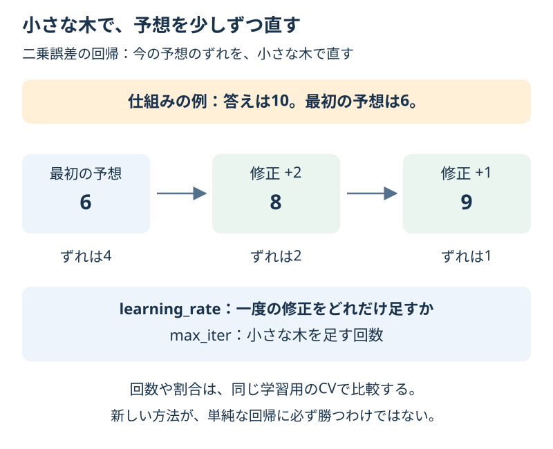

# Chapter 22: 小さな木で予想を少しずつ直す

[学習の道順](../docs/learning-path.md) · 発展編（第2・5・6・7・11・13章の後がおすすめ）

## この章でわかること

小さな木を順番に足す**勾配ブースティング**を学びます。家賃の同じデータで、平均の基準・Ridge・ブースティングを比べます。

## 身近な例と図解

最初の予想が答えより小さかったら、そのずれを埋める修正を足します。一度に大きく変えず、小さな修正を繰り返すイメージです。



第13章の120件の架空の家賃CSVを使います。図の6→8→9は仕組みを説明する数字で、実行結果そのものではありません。

## 実行

```bash
.venv/bin/python scripts/ch22_gradient_boosting.py
```

Windowsは `.venv\Scripts\python.exe scripts/ch22_gradient_boosting.py` です。

## コードの読み方

| コード | していること |
| --- | --- |
| `HistGradientBoostingRegressor(...)` | 小さな木を順番に足して回帰する |
| `learning_rate=0.1` | 一度の修正を小さくする割合 |
| `max_iter=60` | 修正する木を足す最大回数 |
| `max_leaf_nodes=7` | 一つの木の分かれ方を小さく抑える |
| `early_stopping=False` | この例では内部で止めず、指定した60回を比べる |
| `compare_models(...)` | 前処理を含む、学習用90件の同じ5分割CVで比べる |

この回帰の二乗誤差では、今の予想から答えへのずれを直すよう、次の木を学びます。より一般には、損失を減らす方向を表す「勾配」を使います。

第7章の森は、複数の木の予想を平均します。ブースティングは、**前までの予想を直す木を順番に足す**点が違います。

Histという名前は、数値を区間にまとめて木の分割を計算する工夫に由来します。この教材では、新しい外部ライブラリを入れずに試せます。

空欄・文字の準備は第13章のPipelineを使います。木に標準化が必須という意味ではなく、同じ入力の準備を再利用する構成です。前処理はCVの各回の学習側だけで学びます。

## 結果の見方

次は出力例です。道具のバージョンによって小数などが変わる場合があります。

| 方法 | 学習用CVのMAE（万円） |
| --- | --- |
| 平均を答える | 約2.030 |
| Ridge | 約0.704 |
| ブースティング | 約0.945 |

Ridgeが選ばれ、最終テストのMAEは約0.69万円です。ブースティングが必ず勝つわけではありません。
解答ではブースティングの修正割合だけを比べ、0.2が選ばれた最終MAEは約1.11万円です。
別々の練習の結果を見て、最後のテストから方法を選び直しません。

## グラフで見る

`scripts/visualize.py` で `outputs/figures/19_gradient_boosting.png` ができます。
左は3方法の同じCVのMAEです。右はCVの一つの分割で、木を足した回数ごとの学習用・検証用のMAEです。最後のテストを学習経過として見ません。
`Boosting iterations / Training / Validation` は修正回数／学習用／検証用です。

## まずはここだけ

図の予想6に修正2を足すと8です。答え10との差は、4から2になります。森の平均との違いを一言で説明してください。

## 練習問題

1. 回数60と木の大きさを固定し、学習率0.05・0.1・0.2を同じCVで比べてください。
2. CVのMAEが小さい一つを選び、最終テストを一度だけ確認してください。同点ならモデル名順です。
3. 表を `outputs/boosting_rates.csv` に保存し、森とブースティングの違いを書いてください。

## ヒント

`build_boosting(learning_rate=...)` を使います。`compare_models()` に名前とモデルの辞書を渡せます。小さい学習率が、固定した60回で必ずよいとは限りません。

## つまずいたとき

<details>
<summary>回数を増やすほどよい／木なので前処理は不要？</summary>

学習用には合わせやすくなっても、検証用がよくなるとは限りません。また、入力の文字や列の意味を準備する作業は必要です。この例のPipelineでは中央値で空欄を補い、地域を数値の列に変換します。

</details>

## この章のゴール

- [ ] 森の平均と、順番に修正する方法を区別できる。
- [ ] 学習率と回数が、別の設定だと説明できる。
- [ ] 複雑な方法も単純な基準と同じCVで比較できる。

<details>
<summary>理解の確認：CVより最終テストが悪かったら、テストでよかった学習率へ変更する？</summary>

変更しません。最後のテストを設定選びに使うことになります。改善は、新しい評価の計画を立ててから別の実験として行います。

</details>

[解答例](../answers/ch22_answer.py) · [前の章](ch21_group_validation.md) · [次の章](ch23_neural_network.md) · [用語早見表](../cheatsheet.md) · [教材の入口](../README.md)

詳しくは[HistGradientBoostingRegressorの公式説明](https://scikit-learn.org/stable/modules/generated/sklearn.ensemble.HistGradientBoostingRegressor.html)を参照してください。
