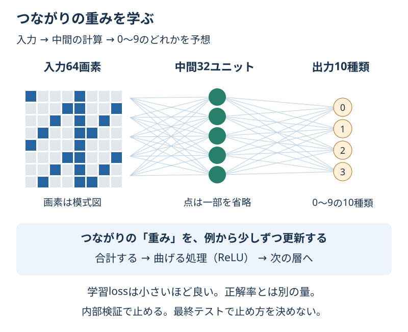

# Chapter 23: ニューラルネットワークで数字を読む

[学習の道順](../docs/learning-path.md) · 発展編（第3・5・6・8章の後がおすすめ）

## この章でわかること

**ニューラルネットワークの層・重み・学習loss**を、手書き数字で学びます。深層学習の入口として、小さな多層パーセプトロン（MLP）を使います。

## 身近な例と図解

一つの画素だけでは数字を決めにくくても、いくつかの画素を組み合わせると形の手がかりになります。計算をつないで、その組み合わせの重みを例から学びます。



第8章と同じ、付属の手書き数字1,797件です。1枚は8×8の64画素、答えは0〜9の10種類。GPUや画像のダウンロードは必要ありません。

## 実行

```bash
.venv/bin/python scripts/ch23_neural_network.py
```

Windowsは `.venv\Scripts\python.exe scripts/ch23_neural_network.py` です。

## コードの読み方

| コード | していること |
| --- | --- |
| `StandardScaler()` | 外側の学習用だけで64画素の尺度を整える |
| `hidden_layer_sizes=(32,)` | 32個のユニットを持つ中間層を一つ作る |
| `activation="relu"` | 合計した値を曲げる処理。負の値を0にする |
| `solver="adam"` | lossを減らすよう重みを更新する方法 |
| `early_stopping=True` | 内部検証の正解率の伸びが止まったら終了する |
| `loss_curve_ / validation_scores_` | 学習loss／内部検証の正解率の記録を見る |

入力64列 → 中間32ユニット → 出力10種類という形です。各ユニットは、入力に重みを掛けて足し、バイアスを加えて、次の計算へ渡します。中間のReLUを使うことで、合計だけを重ねるより複雑な関係を表せます。

**loss（損失）は、学習のずれをまとめた量**です。分類の正解率とは別で、この例では小さいほどよい値です。勾配はlossを減らす方向を調べる手がかりで、Adamが重みを少しずつ更新します。最初は式より、この流れを押さえます。

学習用1,437件・最終テスト360件です。学習用の約15%をネットワーク内部の検証に取り、重みの更新には使わず停止判断に使います。標準化は外側の学習用全体で行います。**独立した実力の評価は、外側のCVと最終テスト**で行います。

`n_iter_no_change=12` は伸びがない回数の目安です。停止後は内部検証が最もよかった重みに戻します。最後に記録されたlossと、保存された重みの回は必ずしも同じではありません。

## 結果の見方

次は出力例です。道具のバージョンによって小数などが変わる場合があります。

出力例では、最多の数字の基準の正解率は0.100、32ユニットのモデルは約0.953です。重みの表は `(64, 32)` と `(32, 10)`、学習は76回で終了しています。

重みは64×32 + 32×10 = 2,368個、バイアスは32 + 10 = 42個です。隠れた層のユニットの値は、そのまま特定の数字を意味するとは限りません。

この結果は小さな付属画像の結果です。スマートフォンの写真や、あらゆる書き方に対応できるとは言えません。回数や小数は環境によって変わる場合があります。

## グラフで見る

`scripts/visualize.py` で `outputs/figures/20_neural_network.png` ができます。
左は記録された学習loss、右は停止判断に使う内部検証の正解率です。縦の点線は最高値を初めて記録した回で、最終テストの結果ではありません。
`Training loss / Internal validation accuracy / Epoch` は学習の損失／内部検証の正解率／学習の繰り返しです。

## まずはここだけ

重みの表 `(64, 32)` の64と32が、図のどこに対応するか指してみてください。

## 練習問題

1. 中間16個と32個を、同じ外側3分割CVで比べてください。正解率の平均が高い設定を選び、最終テストを一度確認します。同点なら小さいユニット数です。
2. 選んだモデルの重みとバイアスの個数を別々に数えてください。
3. 学習lossと内部検証の正解率を `outputs/neural_training_history.csv` に保存し、学習lossだけでは実力を判断できない理由を書いてください。

## ヒント

`compare_widths()` と `build_model(width)` を使います。`coefs_` は重み、`intercepts_` はバイアスです。CVの各回でも、最終テストを内部の早期終了に渡しません。

## つまずいたとき

<details>
<summary>lossと正解率が同じ方向に動かない／学習が収束しないと表示される</summary>

lossと正解率は別の量なので、同じようには動きません。収束の警告は、指定した回数で停止条件に達しなかったという意味です。入力の尺度と、学習用・検証用の経過を見ます。警告を消すだけを目的に最終テストから設定を選ばないようにします。

</details>

## この章のゴール

- [ ] 層とつながりの重みを、図で説明できる。
- [ ] 学習lossと初めての例の正解率を区別できる。
- [ ] 内部検証・外側CV・最終テストの役割を区別できる。

<details>
<summary>理解の確認：画像が64画素なら、出力も64種類？</summary>

違います。64は入力の列数で、この課題の出力は数字0〜9の10種類です。

</details>

[解答例](../answers/ch23_answer.py) · [前の章](ch22_gradient_boosting.md) · [次の章](ch24_anomaly_detection.md) · [用語早見表](../cheatsheet.md) · [教材の入口](../README.md)

詳しくは[MLPClassifierの公式説明](https://scikit-learn.org/stable/modules/generated/sklearn.neural_network.MLPClassifier.html)を参照してください。
