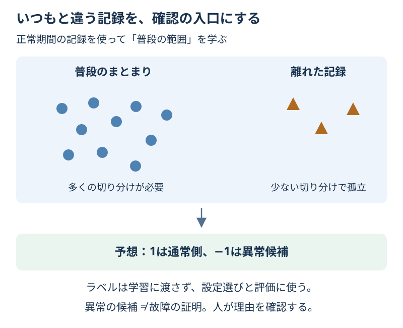

# Chapter 24: いつもと違う記録を見つける

[学習の道順](../docs/learning-path.md) · 発展編（第4・5・9・15章の後がおすすめ）

## この章でわかること

**異常検知**を、普段と違うセンサーの記録を探す題材で学びます。異常の答えを学習に渡さなくても、確認すべき候補を出す方法があります。

## 身近な例と図解

機械の音や温度がいつもと違えば、故障とはまだ決められなくても、理由を調べる入口になります。



正常期間と見立てた240件を学習し、別の検証100件・最終テスト100件を用意します。二つの測定値は架空の尺度で、実際の温度や振動の単位ではありません。検証・テストには各20件の人工的な異常を入れ、評価用の答えを持たせます。

## 実行

```bash
.venv/bin/python scripts/ch24_anomaly_detection.py
```

Windowsは `.venv\Scripts\python.exe scripts/ch24_anomaly_detection.py` です。

## コードの読み方

| コード | していること |
| --- | --- |
| `IsolationForest(...)` | ランダムな切り分けで、孤立しやすい点を探す |
| `model.fit(X_train)` | 正常期間の入力だけから学ぶ。yは渡さない |
| `contamination` | 学習データの異常候補の割合に対応する、境目の設定 |
| `model.predict(X)` | 1を通常側、−1を異常候補として返す |
| `decision_function(X)` | 小さいほど異常側の数値。故障確率ではない |
| `compare_candidates(...)` | ラベル付きの検証用でF1を比べ、設定を選ぶ |

点が密な場所では、他の点から切り離すのに何回も分割が必要です。離れた点は少ない分割で孤立しやすい、という考え方を使います。

この章は**正常期間の例を用意できる条件**です。学習中に正常／異常のラベルを渡さなくても、最初の記録を正常期間と見立てる知識は使っています。あらゆる未知のデータで、この条件が満たせるわけではありません。

`contamination=0.05` は、学習用の約5%を異常候補にする境目の指定です。今後の異常率が5%だと保証する値でも、一件の異常確率でもありません。

第15章の正解番号は0=通常・1=異常ですが、IsolationForestの予想番号は1・−1です。評価するときだけ `predictions == -1` を0/1へ直します。

教師なしで学んでも、どの設定を使うか・実際に役立つかを確かめるための答えや人の確認は必要です。

## 結果の見方

次は出力例です。道具のバージョンによって小数などが変わる場合があります。

検証用では0.02・0.05・0.1を比べ、0.02のF1が約0.976で選ばれます。同点なら小さいcontaminationです。

最終テストでは異常20件を見つけますが、通常80件のうち5件も異常候補になります。precisionは0.800、recallは1.000です。検証用の成績を、将来の確実な成績とは読みません。

入力の誤り、普段と違う運転、実際の故障など、珍しい理由はさまざまです。候補が出たら、追加で確かめます。

## グラフで見る

`scripts/visualize.py` で `outputs/figures/21_anomaly_detection.png` ができます。
同じ検証100件を、左は評価用の答え、右は選んだモデルの候補で表示します。三角が異常側または候補、丸が通常側です。検証用から設定を選んだ後の図であり、独立した最終成績ではありません。
`Ground truth / Flags / Sensor` は答え／異常候補／測定値です。

## まずはここだけ

検証の表でFPを見て、通常の記録を何件確認する必要がありそうか読んでください。

## 練習問題

1. 候補0.15を加え、検証用のF1が高い一つを選んで最終テストを一度確認してください。同点なら小さいcontaminationです。
2. 選んだモデルの検証用を、`decision_function` が小さい順に並べ、上位5件を見てください。
3. 候補表を `outputs/anomaly_candidates.csv` に保存し、人が追加で確認したい理由を2つ挙げてください。

## ヒント

`compare_candidates()` と `choose_candidate()` を使います。異常っぽい順は小さい順です。大きい値を「高い故障確率」と呼ばないようにします。

## つまずいたとき

<details>
<summary>正解ラベルを渡さないのに、検証にラベルがあるのはなぜ？</summary>

学習の方法と、評価の方法は別です。ラベルなしでも普段の形は学べますが、見逃しや誤検知を件数として測るには、確認した答えが必要です。

</details>

## この章のゴール

- [ ] ラベルを渡さない学習と、ラベルを使う評価を区別できる。
- [ ] 予想の1・−1と、正解の0・1を区別できる。
- [ ] 異常の候補を、故障や不正の証明と区別できる。

<details>
<summary>理解の確認：contaminationが0.05なら、新しい記録でも必ず5%が異常候補？</summary>

違います。境目は学習用で決めます。新しい記録の分布が変われば、候補の割合も変わります。

</details>

[解答例](../answers/ch24_answer.py) · [前の章](ch23_neural_network.md) · [次の章](ch25_probability_calibration.md) · [用語早見表](../cheatsheet.md) · [教材の入口](../README.md)

詳しくは[IsolationForestの公式説明](https://scikit-learn.org/stable/modules/generated/sklearn.ensemble.IsolationForest.html)を参照してください。
