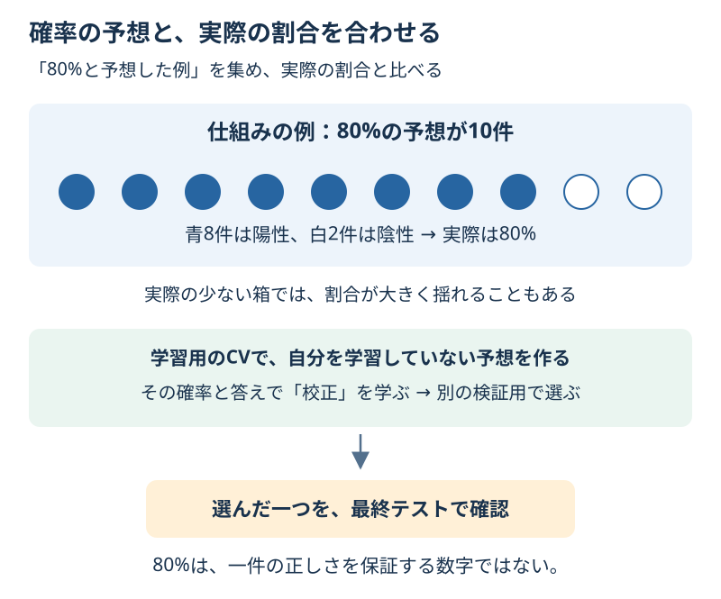

# Chapter 25: 80%という予想を確かめる

[学習の道順](../docs/learning-path.md) · 発展編（第3・4・5・6・15章の後がおすすめ）

## この章でわかること

**確率の校正（キャリブレーション）**を学びます。80%と予想した例の集まりで、実際にも約80%が陽性かを確かめる考え方です。

## 身近な例と図解

10回のうち8回起こるような出来事を80%と予想していれば、確率の言い方は合っています。ただし、一件の出来事が実際に起きるかはまだわかりません。



1,000件の人工データで、答えは出来事なし0／あり1です。6列は架空の測定値です。学習600件・方法選びの検証200件・最終テスト200件に分けます。

## 実行

```bash
.venv/bin/python scripts/ch25_probability_calibration.py
```

Windowsは `.venv\Scripts\python.exe scripts/ch25_probability_calibration.py` です。

## コードの読み方

| コード | していること |
| --- | --- |
| `GaussianNB()` | 分布と特徴の独立性の仮定を使う、最初の確率モデル |
| `CalibratedClassifierCV(..., method="sigmoid")` | モデルの出力から、確率を校正する曲線を学ぶ |
| `cv=StratifiedKFold(...)` | 学習用の中で、その行を学習していない予想を作る |
| `ensemble=False` | 校正にCVの予想を使い、予測の基礎モデルは学習用全体で学ぶ |
| `predict_proba(X)[:, 1]` | 出来事ありの1の確率を取り出す |
| `calibration_table(...)` | 確率を箱に分け、件数・平均確率・実際の割合を比べる |

GaussianNBは、同じ種類の中では各列が独立という仮定と、各列の釣鐘型の分布を使います。
この人工データには互いに関係する列があるため、仮定が合わない場合の確率も確かめます。
校正しただけで、どんなデータでも正しい確率になるわけではありません。
基本モデルの仮定は[Gaussian Naive Bayesの公式説明](https://scikit-learn.org/stable/modules/naive_bayes.html#gaussian-naive-bayes)を参照してください。

学習に使った行の予想だけで校正すると、うまく当てすぎた予想を使うことになります。そこで学習用の内部CVで各行を学習しなかったモデルの予想を作り、その出力と答えの関係を校正します。方法選びの検証200件と、最後の200件はその学習には入りません。

第15章のしきい値変更は、同じ確率からどちらを答えるかを決める境目の変更です。**校正は、確率の出し方を合わせる作業**です。役割が違います。

Brierは「予想確率 − 実際の0/1」の2乗の平均です。たとえば0.8と予想し答え1なら0.04、答え0なら0.64になります。log_lossも確率の採点で、強く言い切って外す予想を重く扱います。どちらも小さいほどよい値です。

Brierの良し悪しには、校正だけでなく例を見分ける力なども関係します。校正曲線と、各箱の件数も一緒に読みます。空の箱には観測割合がないので、省きます。

## 結果の見方

次は出力例です。道具のバージョンによって小数などが変わる場合があります。

| 方法 | 検証用Brier | 検証用log_loss | 検証用の正解率 |
| --- | --- | --- | --- |
| 校正前 | 約0.150 | 約0.900 | 約0.835 |
| sigmoidで校正 | 約0.131 | 約0.425 | 約0.840 |

検証用のBrierが小さいsigmoidを選び、同点ならモデル名順です。選んだ学習済みモデルをそのまま使い、最終テストのBrierは約0.156、正解率は0.790です。
検証用を混ぜて学び直すと、選んだ確率の出し方も変わるため、この例では混ぜません。

検証の0.8〜1.0の箱は80件、平均の予想確率は約0.877、実際の陽性割合は約0.925です。
少ない箱には5〜6件しかなく、割合も揺れます。

## グラフで見る

`scripts/visualize.py` で `outputs/figures/22_probability_calibration.png` ができます。
左は検証用の予想確率の平均と実際の陽性割合です。点線に近いほど両者が合う目安になります。右は同じ5箱の件数です。線だけでなく、少ない箱を確認します。
`Mean predicted probability / Observed positive fraction / Count` は平均の予想確率／実際の陽性割合／件数です。

## まずはここだけ

80%と予想して答えが1だったときのBrierへの寄与0.04と、答え0のときの0.64を計算してください。

## 練習問題

1. 校正法isotonicを加え、別の検証用のBrierで方法を選び、最終テストを一度確認してください。同点ならモデル名順です。
2. 選んだモデルの検証用を5箱と10箱に分け、各箱の件数と割合を比べてください。
3. 表を `outputs/probability_bins.csv` に保存し、80%という確率と一件の正しさの違いを書いてください。

## ヒント

`compare_models(..., methods=("sigmoid", "isotonic"))` を使います。isotonicは形を柔軟にできる分、少ない校正例では合わせすぎることがあります。箱の細かさはグラフの読み方の比較で、最終テストの選び直しではありません。

## つまずいたとき

<details>
<summary>正解率が近いのに、確率の採点は大きく違う</summary>

0.5を超えたかだけを見る正解率では、0.6と0.99の違いを捨てています。確率の採点ではその違いも見ます。校正が、分類の正解率を必ず上げるわけではありません。

</details>

## この章のゴール

- [ ] 確率の集まりと、実際の割合を比べて読める。
- [ ] しきい値を変える作業と、確率を校正する作業を区別できる。
- [ ] 校正の学習・方法選び・最終評価を分けられる。

<details>
<summary>理解の確認：80%と予想した一件が外れたら、確率のモデルは間違い？</summary>

一件だけでは判断できません。80%の予想でも外れる例はあります。多数の例を集め、その割合と件数を見ます。

</details>

[解答例](../answers/ch25_answer.py) · [前の章](ch24_anomaly_detection.md) · [次の章](ch26_prediction_intervals.md) · [用語早見表](../cheatsheet.md) · [教材の入口](../README.md)

詳しくは[確率の校正の公式説明](https://scikit-learn.org/stable/modules/calibration.html)を参照してください。
