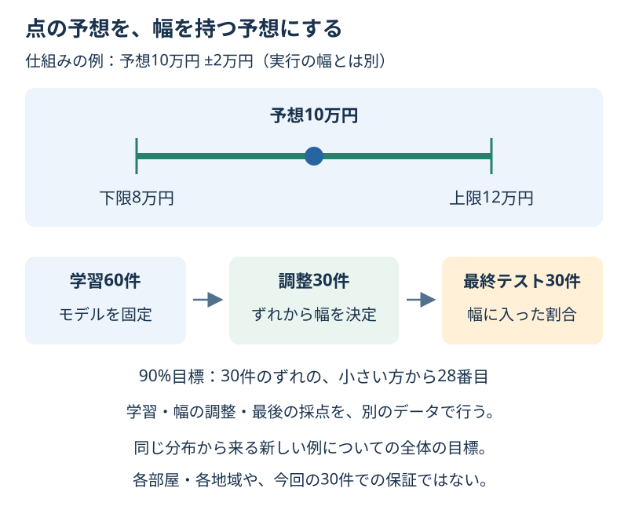

# Chapter 26: 予想を幅で伝える

[学習の道順](../docs/learning-path.md) · 発展編（第2・5・6・13章の後がおすすめ）

## この章でわかること

一つの数値だけでなく、**予測区間**として幅を伝える方法を学びます。Split Conformal Predictionという方法の入口です。

## 身近な例と図解

家賃を10万円と一つだけ予想するより、「8〜12万円の幅」と伝えると、ずれがありうることも見えます。図の±2万円は仕組みの例で、実行の幅とは別です。



第13章の架空の家賃CSVを、学習60件・幅の調整30件・最終テスト30件に分けます。前処理と回帰は学習用60件で固定します。

## 実行

```bash
.venv/bin/python scripts/ch26_prediction_intervals.py
```

Windowsは `.venv\Scripts\python.exe scripts/ch26_prediction_intervals.py` です。

## コードの読み方

| コード | していること |
| --- | --- |
| `model.fit(X_train, y_train)` | 学習60件だけで前処理と回帰を学ぶ |
| `abs(y_cal - model.predict(X_cal))` | 別の調整用30件で、予想のずれの大きさを測る |
| `ceil((n + 1) * coverage)` | 目標割合に小さな補正を加え、使う順位を決める |
| `conformal_radius(..., 0.9)` | ずれを小さい順に並べ、28番目を半幅にする |
| `prediction - radius / prediction + radius` | 下限／上限を作る |
| `covered` | 実際の答えが下限以上・上限以下に入ったかを確認する |

点の予想を作ったモデルは、そのまま固定します。幅を調整する例まで混ぜて学び直すと、測ったずれと使うモデルの条件が変わってしまいます。

30件で90%を目標にすると、(30+1)×0.9 = 27.9を切り上げ、**小さい方から28番目**のずれを使います。単に全データのMAEを足す方法でも、何でも90%の位置を補間する方法でもありません。

この基本例は、調整用と新しい例が同じ分布から来るなど、順番を交換しても統計的な扱いが変わらない条件（交換可能性）を前提にします。独立に同じ分布から取ることは、その条件を満たす例です。時系列や相場の変化に、そのまま保証を持ち込めません。

理論上の割合は、調整用データの取り方と新しい例の両方を通した全体の割合です。**各部屋・各地域ごとの90%保証や、今回の30件で必ず90%以上という保証ではありません。**

ここで作る幅は新しい答えの予測区間です。平均や回帰係数の信頼区間とは別です。この単純な方法では、全ての部屋に同じ半幅を使います。

## 結果の見方

次は出力例です。道具のバージョンによって小数などが変わる場合があります。

目標90%では、半幅約1.74万円、全幅約3.48万円になります。点の予想が10万円なら、おおよそ8.26〜11.74万円です。

最終テスト30件では30件すべてが幅に入り、実測100%でした。目標90%と実測100%は別です。次の30件でも100%になる保証はなく、テストを見て幅を狭く選び直しません。

80%目標では半幅約1.23万円です。同じ調整用とモデルなら、目標割合を上げると幅は狭くなりません。高い割合と狭い幅を同時に自由に選べるわけではありません。

## グラフで見る

`scripts/visualize.py` で `outputs/figures/23_prediction_intervals.png` ができます。
左は調整用30件のずれを小さい順に並べ、28番目の半幅を示します。右は最終テストの点の予想と区間、実際の答えです。棒は標準偏差や信頼区間ではありません。
`Calibration errors / Prediction with interval / Actual` は調整用のずれ／予想と予測区間／実際の答えです。

## まずはここだけ

半幅1.74万円のとき、予想10万円の下限・上限・全幅を計算してください。

## 練習問題

1. 同じモデルと調整用で、80%目標と90%目標の半幅・全幅を比較してください。テストを見て目標を選びません。
2. 先に決めた90%目標だけを最終テストで確認し、目標と実測の割合を区別して書いてください。
3. 点の予想・上下限・実際の答え・幅に入ったかを `outputs/rent_intervals.csv` に保存し、前提と保証の範囲を説明してください。

## ヒント

`conformal_radius(residuals, coverage=...)` と `interval_table()` を使います。30件で80%なら25番目、90%なら28番目です。各目標の幅は調整用だけで決めます。

## つまずいたとき

<details>
<summary>99%目標にするとinfが出る／全件入るように幅を直してよい？</summary>

30件で99%なら31番目が必要です。この方法ではその位置を無限大として扱い、有限な幅を作りません。テストで幅を直すと、そのテストは幅の調整に使った例になります。新しい評価が必要です。

</details>

## この章のゴール

- [ ] 学習・幅の調整・最終評価を別のデータで行える。
- [ ] 半幅・全幅・目標割合・実測割合を区別できる。
- [ ] 区間の前提と、各部屋ごとの保証ではないことを説明できる。

<details>
<summary>理解の確認：この幅を第19章の時系列にそのまま付ければ、同じ保証が使える？</summary>

そのままでは言えません。時間による依存や分布の変化があると、この基本例の前提を満たさないことがあります。時系列向けの別の方法や評価が必要です。

</details>

[解答例](../answers/ch26_answer.py) · [前の章](ch25_probability_calibration.md) · [次の章](ch27_monitoring.md) · [用語早見表](../cheatsheet.md) · [教材の入口](../README.md)

詳しくは[Conformal Predictionの入門論文](https://arxiv.org/abs/2107.07511)を参照してください。
