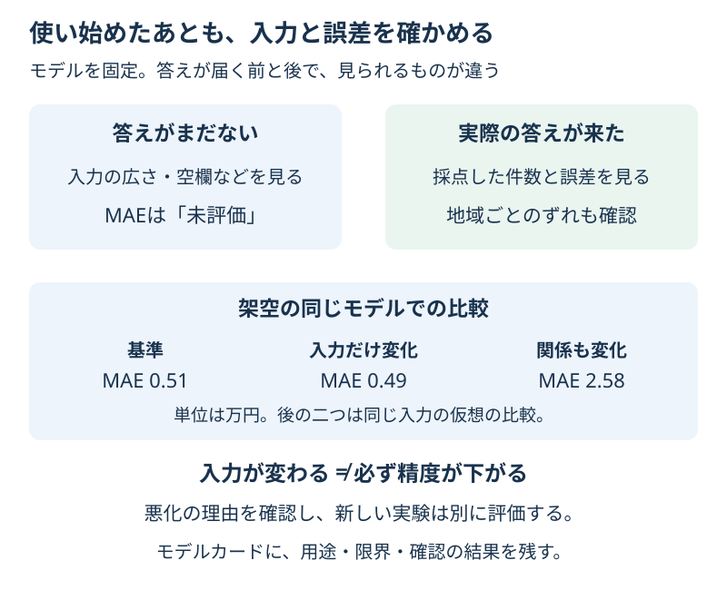

# Chapter 27: 使い始めたあとも確かめる

[学習の道順](../docs/learning-path.md) · 発展編（第2・4・6・13・17章の後がおすすめ）

## この章でわかること

**モデルの監視と、結果の説明**を学びます。入力の変化、精度の変化、採点した件数を分けて確認し、[モデルカード](../docs/model-card.md)に用途と限界を残します。

## 身近な例と図解

お店の来客層や部屋の条件が変わると、これまでのモデルがうまく使えるかを確かめたくなります。予想を出した時点では、実際の答えがまだわからないこともあります。



最初の300件で学び、その後の120件ずつの状況を確かめる、架空の家賃の例です。後の二つの状況は同じ新しい入力を使う仮想の比較で、「関係も変化」だけ答えに2.5万円を足しています。現実の相場の記録ではありません。

## 実行

```bash
.venv/bin/python scripts/ch27_monitoring.py
```

Windowsは `.venv\Scripts\python.exe scripts/ch27_monitoring.py` です。

## コードの読み方

| コード | していること |
| --- | --- |
| `monitoring_data()` | 学習用と、基準・入力変化・関係変化の状況を用意する |
| `build_model().fit(X_train, y_train)` | 最初の300件だけでモデルを固定する |
| `area_mean_sqm` | 入力の平均の広さを、基準の状況と比べる |
| `n_rows / n_labeled` | 全件数／答えが届いて採点した件数を区別する |
| `summarize_batch(..., y=None, ...)` | 答えがない間はMAEを未評価にする |
| `group=all / central / suburb` | 全体と地域別の誤差・件数を確認する |

**データドリフト**は、使い始めたあとのデータの分布が変わることです。入力が変わることと、入力から答えへの関係が変わることを区別して考えます。

この例では、平均の広さの差が10㎡を超えたら入力を確認、MAEが1.5万円を超えたら誤差を確認、という目安を先に決めています。説明用の値で、統計的な証明や実際の運用の共通基準ではありません。地域別の入力アラートは、この例では計算していません。

実際の家賃がまだわからなければ、MAEもまだわかりません。0にすると「完全に当たった」と読み違えます。`NaN` と「未評価」で残します。一部の答えだけ来たなら、その件数と欠け方も読みます。

全体の平均だけでは、一部の集団の大きなずれを見落とすことがあります。地域ごとの誤差も見ますが、**同じMAEだけで公平性を決められるわけではありません**。誰がどんな不利益を受けるか、用途と人の確認を含めて考えます。

モデルカードには、用途・入力と単位・学習と評価の条件・集団別の結果・未確認の範囲・監視後の対応を書きます。個人情報を含む実データを扱う場合は、必要な列と利用の根拠、記録の扱いも確認します。

## 結果の見方

次は出力例です。道具のバージョンによって小数などが変わる場合があります。

| 状況 | 全体の平均の広さ | 全体のMAE |
| --- | --- | --- |
| 基準 | 約43.93㎡ | 約0.51万円 |
| 入力だけ変化 | 約61.13㎡ | 約0.49万円 |
| 関係も変化 | 約61.13㎡ | 約2.58万円 |

入力だけ変わった状況でも、モデルはこの人工的な関係を予想できています。
同じ新しい入力で、答えの関係も変わると誤差が大きくなります。
入力の変化を見つけたことだけから、精度が下がったと断定しません。

## グラフで見る

`scripts/visualize.py` で `outputs/figures/24_monitoring.png` ができます。
左は基準と新しい入力の広さの分布、右は3状況の全体・地域別のMAEです。点線は先に決めた説明用の1.5万円の目安です。
`Reference / Input shift / Relationship shift / Central / Suburb` は基準／入力変化／関係変化／中心部／郊外です。

## まずはここだけ

答えがまだ来ない状況で、確認できる数字と確認できない数字を一つずつ挙げてください。

## 練習問題

1. 関係も変わった状況で、答えなしの監視表を作り、MAEが未評価になることを確認してください。
2. 答えが40件だけ届いた場合と120件すべて届いた場合を比べ、地域ごとの採点件数も見てください。表を `outputs/monitoring_label_delay.csv` に保存します。
3. [モデルカード](../docs/model-card.md)の用途・限界・悪化時の対応を、実行結果に合わせて書いてください。

## ヒント

`summarize_batch(model, X, None, ...)` は答えなしの表です。一部の答えがないときは、yの該当部分を `NaN` にします。モデルをその場で学び直さず、最初の条件を固定して比べます。

## つまずいたとき

<details>
<summary>入力アラートが出たのにMAEは良い／答えがないと何もできない？</summary>

入力の変化と誤差は別なので、両方を見ます。答えがなくても列・単位・空欄・分布などは確認できます。悪化を見て改良する場合は、新しい学習と評価を別に計画し、使うモデルの版も記録します。

</details>

## この章のゴール

- [ ] 入力の変化と精度の変化を区別して監視できる。
- [ ] 答えがない状態と、少数の答えだけで採点した状態を説明できる。
- [ ] 用途・集団別の結果・限界・対応をモデルカードに残せる。

<details>
<summary>理解の確認：一部の40件のMAEが良ければ、残り80件も良い？</summary>

保証できません。どんな答えが先に届いたかが偏っていることもあります。件数・欠け方・集団別の結果を確認します。

</details>

[解答例](../answers/ch27_answer.py) · [前の章](ch26_prediction_intervals.md) · [総合課題](../docs/capstone.md) · [用語早見表](../cheatsheet.md) · [教材の入口](../README.md)

詳しくは[モデルカードの原論文](https://arxiv.org/abs/1810.03993)を参照してください。
